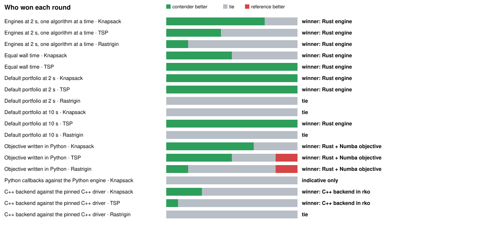
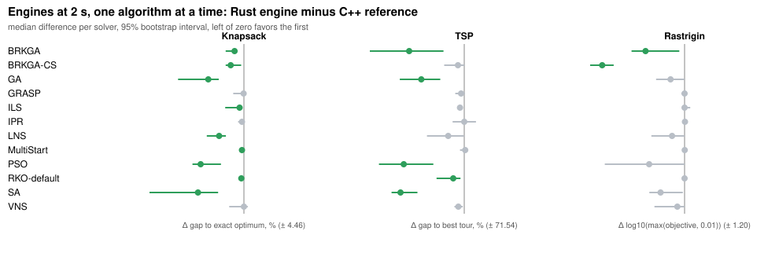
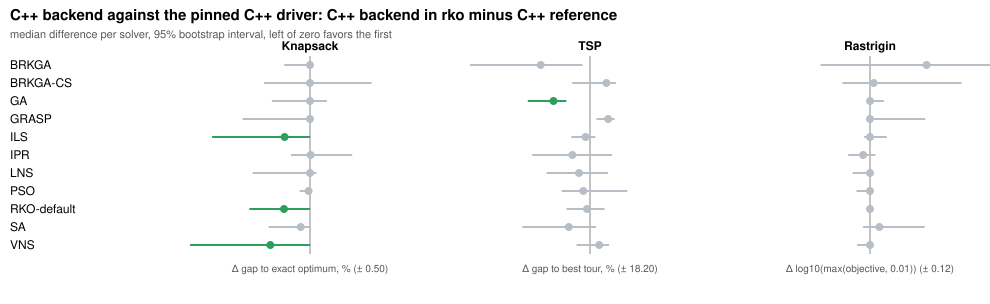

# Performance benchmarks

Each section identifies its workload and limits. Synthetic fixed-work and
allocation probes complement the historical Knapsack reference; no single case
establishes general optimization quality or native-code performance parity. The
[native engine study](#native-engine-versus-c-and-python) compares the compiled
backend with C++ on three problem families.
See [the C++ acceptance target and native-backend gates](../docs/performance.md)
for end-to-end quality/time/resource criteria; historical Python results must not
be merged with corrected-revision observations as if they were one experiment.

## Bounded model decoder development port

`modeling_cases.py`, `modeling_validation.py` and `modeling_overhead.py` now use
`rko_solver`. Model execution is explicitly Python with sequential/thread/process
scheduling; repair defaults to continuous with a common 1,024-sweep cap.

```bash
uv run --locked --group model-validation --extra pyomo --extra pulp --extra mathopt python -m benchmarks.modeling_validation --repair continuous --repair-max-sweeps 1024 --seeds 10 --time-limit 0.5 --output docs/audits/my-renamed-model-validation.jsonl
uv run --locked python -m benchmarks.modeling_overhead --baseline 8917000 --repeats 51 --target-seconds 0.8 --output docs/audits/my-renamed-model-overhead.json
```

Preserved **historical**, unmodified evidence from the qualified pre-rename source:

- [Restored campaign](modeling-validation-reference-13b6934.jsonl): 480 runs,
  420 feasible, zero semantic/execution errors; exact-demand transport60/60.
- [Same-source box control](modeling-validation-box-reference-13b6934.jsonl):
  480 runs,314 feasible, exact-demand0/60 at identical tolerances/models/budgets.
- [Archive/IPC and feature costs](modeling-overhead-reference-13b6934.json) and
  [platform qualification](modeling-platform-reference-13b6934.json) identify
  their original13b6934 source, not the renamed port.

No historical JSON source hashes or package paths were rewritten. Current feature
and API tests run in the canonical checkout, but the stricter structure/type gate
still fails on transferred code. Refactor without weakening its ratchet, then
refresh full platform/package/performance evidence before calling the port ready.
[Model contracts](../docs/modeling.md) and [historical results](../docs/model-validation.md)
explain bounds, integer limits, independent checks and publication restrictions.

## Original-decoder decision recording overhead

`decision_traces.py` compares disabled/enabled bounded recording at identical completed
evaluation counts for cheap/heavier generic vector callbacks. Timing and Python
allocation sampling use separate equal-work passes. No search-quality, zero-overhead,
whole-process RSS or generic engine speedup claim follows from these observations.

```bash
OPENBLAS_NUM_THREADS=1 OMP_NUM_THREADS=1 uv run --locked python -m benchmarks.decision_traces --evaluations 1000 --dimension 64 --repeats 3
```

See [recording limits and interpretation](../docs/decision-traces.md). Keep raw JSON
and its source/runtime context when comparing runs; measure process transport
separately for your workload.

## Source-identified fixed-work baseline

```bash
uv run --locked python -m benchmarks.performance_profile --dimension 20 --evaluations 64
uv run --locked python -m benchmarks.performance_profile --dimension 20 --evaluations 64 --profile
```

This entry point reuses `fixed_work` and emits one JSON object with source/config/
helper hashes, Git/environment observations and replay fingerprints. Optional
cProfile output reports the top 20 functions by exclusive time. Search timing
excludes setup/startup; profiling includes runner construction and pool seeding.
Profiled times are diagnostic, not acceptance evidence. CPU observations do not
certify native teams or isolation. No memory, whole-solver or C++ claim follows.
See the [contract checklist and measurement boundaries](../docs/performance-baseline.md).
Do not run competing experiments on the protected historical benchmark's host.

## Hosted fixed-work baseline screening

The [baseline workflow](../.github/workflows/performance-study.yml) collects 216
plain/profiled observations on hosted runners, never on the protected historical
benchmark's host. It retains raw JSONL and host observations, validates 108 exact
replay pairs across 36 groups, and uploads a compact report. Profile totals include
runner setup; unprofiled search times do not. These are descriptive three-seed
synthetic screens, not speedup, quality, stage-completion or C++ evidence.

To validate downloaded raw shards:

```bash
uv run --locked python -m benchmarks.performance_report --input-dir raw --output report/summary.json
```

The report rejects duplicates, missing pairs, changed replay, invalid times and
mixed source/runtime identities. It does not invent zero cost for functions missing
from truncated top lists. See [scope and limits](../docs/performance-baseline.md#hosted-fixed-work-screening).

## Invocation and resource study

The [hosted invocation workflow](../.github/workflows/invocation-study.yml) reuses
`startup_stages.py`, `process_budget.py` and `native_threads.py`. It validates six
startup solves, twelve portfolio/resource solves and 36 native-callback prefix
observations plus two parent-only controls, preserving raw stdout/stderr, helper/
source identity, host observations and copied native-thread settings.

`process_budget.py` records constructor-plus-solve `invocation_seconds`, internal
`elapsed_seconds` and per-search metadata. Sampled coordinator/direct-child RSS
is not unique physical memory or an exact peak. A fresh entire probe process is
not one cold solver invocation; the different probes/VMs must not be pooled.
See [timing, memory and resource boundaries](../docs/invocation-profile.md).

## Spawn startup and installation layout

```bash
uv run --locked python benchmarks/startup_stages.py
```

This guarded benchmark instruments real parent validation, manager startup,
worker entry/preparation and first decoder calls. It checks every observed
worker's first keys against its reported execution seed, validates final keys/
objective and reports environment/source paths. `--repeats 1` supports alternating
separate interpreter environments; the default runs three one/four-worker pairs.

Explicit reference: [startup-layout-reference.jsonl](startup-layout-reference.jsonl),
2026-10-19 WSL2, four available CPUs, CPython 3.14.8 / NumPy 2.4.3, baseline
`efc40e3`. Eighteen solves alternated three installation layouts, using the same
32 installed distribution name/version pairs and byte-identical 55 installed
Python/TOML files. All used the full ten-algorithm online portfolio, 128 keys,
seed 42 and a 0.2-second common search budget. The checkout, benchmark script,
working directory and temporary observation filesystem stayed fixed.

| Installation layout | Workers | End-to-end median (s) | Manager-start median (s) | Latest first-callback median (s) |
| --- | ---: | ---: | ---: | ---: |
| Windows-mounted environment + editable Windows-mounted source | 1 | 5.507 | 2.336 | 5.116 |
| Linux-local environment + same editable source | 1 | 3.550 | 1.468 | 3.192 |
| Linux-local environment + non-editable Linux-local installation | 1 | 1.559 | 0.494 | 1.115 |
| Windows-mounted environment + editable Windows-mounted source | 4 | 6.174 | 2.298 | 5.746 |
| Linux-local environment + same editable source | 4 | 4.262 | 1.585 | 3.840 |
| Linux-local environment + non-editable Linux-local installation | 4 | 1.786 | 0.493 | 1.363 |

The last layout reduced these environment-specific end-to-end medians by about
71–72%. This is **installation/filesystem evidence, not a library optimization**.
Latest first callback means the maximum across workers in each trial, then the
median across three trials. Parent construction medians were 0.111–0.129 s for
the mounted installation and 0.009–0.014 s for the local non-editable installation;
removing fail-fast validation would miss most of the observed delay.

Fresh processes do not imply cold OS caches. Instrumentation, WSL storage and host
load affect timings; preliminary runs varied substantially. Budgets differ by
worker cap and timed trajectories may differ: these are not equal-work throughput,
RSS, quality or native-Windows results. Imports and spawn remain nonzero even in
the fastest layout. No import protocol, worker architecture or validation was
changed. See [WSL setup guidance](../docs/running.md#wsl-startup-and-virtual-environment-placement).

## Native engine versus C++ and Python

The compiled engine (`engine="rust"`, [guide](../docs/native.md)) was compared with the
pinned C++ reference and with the Python engine on three problem families and four ways of
defining a problem. **Every claim is limited to the named problems, budgets, machine and
parameter grids.** The library is general and Knapsack is only an example problem, so no
optimization or default was chosen from Knapsack evidence alone.

### Protocol

- **Identification.** Native engine at Git `7d1134e` (recorded in every raw row with the
  host, compiler, interpreter and, for the native binary, its hash). C++ reference `126e358`
  with the same 64-bit Knapsack patch as the section below; TSP and Rastrigin replace only
  `Problem.h`; all three widen written keys to 17 digits. WSL2 on an Intel Core i7-1255U with
  6 logical CPUs, CPython 3.14.4, NumPy 2.4.3, g++ 15.2, rustc 1.98.0, Numba 0.68.
- **Three disjoint instance sets.** The native Nelder-Mead pool policy was screened on a
  subset of the pinned sample above. The descent order, the IPR seeding and the worker default
  were chosen on a **calibration** set (seed `20261020`). The numbers below come from a
  different **held-out** set (seed `20261031`) that no decision used. KPLIB selection seeds
  were checked to share no instance with the pinned sample, the calibration set or the first
  held-out round.
- **Problems.** (1) 15 KPLIB 500-item Knapsack instances scored against exact optima. (2)
  Euclidean TSP with rounded distances decoded by sorting keys: 6 instances of 100 cities
  and 6 of 300. (3) Shifted Rastrigin over `[-5.12, 5.12)`: 6 instances of 30 and 6 of 100
  dimensions. None has constant-time move evaluation; Knapsack runs through the same
  generic evaluation path (the telemetry wrapper does not expose an incremental evaluator).
- **Settings.** One algorithm at a time (one thread) and the ten-algorithm default portfolio
  (ten threads on both sides, on six logical CPUs), adaptive control, pool size 10,
  sequential-acceptance local search (strategy 1, the C++ benchmark setting), three
  replicates, nominal budget 2 s unless stated. Implementations run sequentially, alternating
  order. Native and C++ both use the C++ online parameter grids, so the comparison is engine
  against engine; Python-defined problems use the same grids through generated TOML files.
- **Scoring.** Every returned key vector is decoded and scored again in Python and must
  equal the reported objective (Knapsack/TSP exactly, C++ Rastrigin to its six printed
  decimals). Scores are lower-is-better; the statistics are described under "Results at a
  glance". **All 5,775 first-round trials and the 3,429 C++ backend trials completed; none
  failed.**

<!-- native-report:start -->
<!-- Generated by `python -m benchmarks.native_report render`; do not edit. -->

### Results at a glance

🟢 contender significantly better · ⚪ no significant difference (a tie) · 🔴 significantly worse · ⚠️ too few instances to decide.



- 🏆 **Rust engine against the C++ reference:** won 8 of 11 rounds, tied 3, lost 0.
- 🐍 **Objective written in Python, against the C++ reference:** Numba is better in Knapsack, TSP, Rastrigin; NumPy block objectives are better in Knapsack; worse in TSP, Rastrigin.
- ✅ **C++ backend parity:** 0 solver comparisons worse than the pinned driver, 17 of 33 proven equivalent within the margins below (the rest are inconclusive, not different).

| Round | Family | Contenders | Outcome | 🟢 / ⚪ / 🔴 | Ranking (mean rank) |
| --- | --- | --- | --- | :---: | --- |
| Engines at 2 s, one algorithm at a time | Knapsack (15) | C++ reference vs Rust engine | 🏆 **Rust engine** | 9 / 3 / 0 | 🥇 Rust engine (1.18) · 🥈 C++ reference (1.82) |
| Engines at 2 s, one algorithm at a time | TSP (12) | C++ reference vs Rust engine | 🏆 **Rust engine** | 5 / 7 / 0 | 🥇 Rust engine (1.19) · 🥈 C++ reference (1.81) |
| Engines at 2 s, one algorithm at a time | Rastrigin (12) | C++ reference vs Rust engine | 🏆 **Rust engine** | 2 / 10 / 0 | 🥇 Rust engine (1.33) · 🥈 C++ reference (1.67) |
| Equal wall time | Knapsack (15) | C++ reference vs Rust engine | 🏆 **Rust engine** | 2 / 2 / 0 | 🥇 Rust engine (1.30) · 🥈 C++ reference (1.70) |
| Equal wall time | TSP (12) | C++ reference vs Rust engine | 🏆 **Rust engine** | 4 / 0 / 0 | 🥇 Rust engine (1.10) · 🥈 C++ reference (1.90) |
| Default portfolio at 2 s | Knapsack (15) | C++ reference vs Rust engine | 🏆 **Rust engine** | 1 / 0 / 0 | 🥇 Rust engine (1.10) · 🥈 C++ reference (1.90) |
| Default portfolio at 2 s | TSP (12) | C++ reference vs Rust engine | 🏆 **Rust engine** | 1 / 0 / 0 | 🥇 Rust engine (1.00) · 🥈 C++ reference (2.00) |
| Default portfolio at 2 s | Rastrigin (12) | C++ reference vs Rust engine | 🤝 **tie** | 0 / 1 / 0 | 🥇 Rust engine (1.46) · 🥈 C++ reference (1.54) |
| Default portfolio at 10 s | Knapsack (15) | C++ reference vs Rust engine | 🤝 **tie** | 0 / 1 / 0 | 🥇 Rust engine (1.27) · 🥈 C++ reference (1.73) |
| Default portfolio at 10 s | TSP (12) | C++ reference vs Rust engine | 🏆 **Rust engine** | 1 / 0 / 0 | 🥇 Rust engine (1.17) · 🥈 C++ reference (1.83) |
| Default portfolio at 10 s | Rastrigin (12) | C++ reference vs Rust engine | 🤝 **tie** | 0 / 1 / 0 | 🥇 C++ reference (1.50) · 🥇 Rust engine (1.50) |
| Objective written in Python | Knapsack (15) | C++ reference vs Rust + Numba objective vs Rust + NumPy block objective | 🏆 **Rust + Numba objective** | 4 / 2 / 0 | 🥇 Rust + Numba objective (1.21) · 🥈 Rust + NumPy block objective (2.17) · 🥉 C++ reference (2.62) |
| Objective written in Python | TSP (12) | C++ reference vs Rust + Numba objective vs Rust + NumPy block objective | 🏆 **Rust + Numba objective** | 3 / 2 / 1 | 🥇 Rust + Numba objective (1.00) · 🥈 C++ reference (2.42) · 🥉 Rust + NumPy block objective (2.58) |
| Objective written in Python | Rastrigin (12) | C++ reference vs Rust + Numba objective vs Rust + NumPy block objective | 🏆 **Rust + Numba objective** | 1 / 4 / 1 | 🥇 C++ reference (1.68) · 🥇 Rust + Numba objective (1.68) · 🥉 Rust + NumPy block objective (2.64) |
| Python callbacks against the Python engine | Knapsack (5) | Python engine vs Rust + Python callbacks vs Rust + NumPy block objective vs Rust + Numba objective | ⚠️ indicative only: Rust + Numba objective | 0 / 36 / 0 | 🥇 Rust + Numba objective (1.34) · 🥈 Rust + NumPy block objective (1.74) · 🥉 Rust + Python callbacks (3.12) · 4. Python engine (3.80) |
| C++ backend against the pinned C++ driver | Knapsack (15) | C++ reference vs C++ backend in rko | ✅ **parity**: no solver worse, 3 better | 3 / 8 / 0 | 🥇 C++ backend in rko (1.36) · 🥈 C++ reference (1.64) |
| C++ backend against the pinned C++ driver | TSP (12) | C++ reference vs C++ backend in rko | ✅ **parity**: no solver worse, 1 better | 1 / 10 / 0 | 🥇 C++ backend in rko (1.43) · 🥈 C++ reference (1.57) |
| C++ backend against the pinned C++ driver | Rastrigin (12) | C++ reference vs C++ backend in rko | ✅ **parity**: no solver worse | 0 / 11 / 0 | 🥇 C++ backend in rko (1.48) · 🥈 C++ reference (1.52) |

Rounds decided (parity and underpowered rounds excluded), by contender:

| Contender | 🏆 Rounds won | 🤝 Tied | Lost to another contender |
| --- | ---: | ---: | ---: |
| Rust engine | 8 | 3 | 0 |
| Rust + Numba objective | 3 | 0 | 0 |
| Rust + NumPy block objective | 0 | 0 | 3 |
| C++ reference | 0 | 3 | 11 |

C++ backend parity: ✅ 3 of 3 families, ❌ 0 regressions.

**How to read this.** Lower scores are better everywhere.

- **Unit of analysis.** Replicates collapse to one median per instance; the instance, not the trial, is the sample. Each solver is compared with the reference on the same instances (paired).
- **Test.** Exact two-sided signed-rank permutation test (ties and zero differences handled exactly), Holm-adjusted over the solvers of the round. 🟢/🔴 mean the adjusted p is below 0.05; anything else is ⚪ a tie, never a win.
- **Size of the difference.** Δ is the median paired difference with a 95 % bootstrap interval (10,000 resamples, seed 20261110); r is the rank-biserial correlation (−1: the contender is better on every instance, 0: no tendency).
- **Round winner.** The contender no other contender beats on net (significantly better solvers minus worse ones). Several unbeaten contenders tie for first. Rounds whose instance count cannot reach significance are marked ⚠️ and not counted.
- **Parity** (C++ backend round) is tested by interval inclusion: the 90 % interval of Δ must lie inside the stated margin. That is a claim of practical equivalence, stronger than "not significantly different". Margins (0.25 gap points for Knapsack, 2 for TSP, 0.1 decades for Rastrigin) were fixed when this analysis was written, after the data existed.
- **Scores.** Knapsack: gap to the exact optimum in percent; an infeasible result (five Python-engine trials in the callback round) scores 100, the worst possible gap. TSP: gap to the best tour of the round, percent. Rastrigin: log10(max(objective, 0.01)), so an objective below 0.01 counts as solved.





### Per-solver evidence

Expand a round for every solver's paired result, effect size and winner.

<details><summary><b>Engines at 2 s, one algorithm at a time — Knapsack</b> (15 instances, score: gap to exact optimum, %)</summary>

_Is the Rust engine better than the C++ reference with the same parameters?_ 12 solvers, 3 replicates, nominal 2 s.

| Solver | Contender | Median score (contender vs reference) | Δ median [95% CI] | Better / worse / tied | Holm p | Effect r | Winner |
| --- | --- | ---: | ---: | :---: | ---: | :---: | --- |
| BRKGA | Rust engine | 0.621 vs 0.983 | -0.441 [-0.864, -0.312] | 12 / 0 / 3 | 0.006 | -1.00 (large) | 🟢 **Rust engine** |
| BRKGA-CS | Rust engine | 0.265 vs 0.889 | -0.624 [-0.863, -0.131] | 12 / 0 / 3 | 0.006 | -1.00 (large) | 🟢 **Rust engine** |
| GA | Rust engine | 1.955 vs 4.210 | -1.686 [-3.111, -1.188] | 12 / 0 / 3 | 0.006 | -1.00 (large) | 🟢 **Rust engine** |
| GRASP | Rust engine | 0.616 vs 0.909 | -0.014 [-0.505, +0.000] | 8 / 4 / 3 | 0.235 | -0.54 (large) | ⚪ tie |
| ILS | Rust engine | 0.185 vs 0.524 | -0.204 [-0.886, -0.075] | 12 / 0 / 3 | 0.006 | -1.00 (large) | 🟢 **Rust engine** |
| IPR | Rust engine | 7.217 vs 7.401 | -0.094 [-0.275, +0.001] | 9 / 5 / 1 | 0.235 | -0.54 (large) | ⚪ tie |
| LNS | Rust engine | 1.305 vs 2.806 | -1.172 [-1.754, -0.850] | 12 / 0 / 3 | 0.006 | -1.00 (large) | 🟢 **Rust engine** |
| MultiStart | Rust engine | 7.319 vs 7.413 | -0.095 [-0.199, +0.000] | 11 / 1 / 3 | 0.020 | -0.87 (large) | 🟢 **Rust engine** |
| PSO | Rust engine | 1.243 vs 2.743 | -2.044 [-2.433, -1.088] | 12 / 0 / 3 | 0.006 | -1.00 (large) | 🟢 **Rust engine** |
| RKO-default | Rust engine | 0.046 vs 0.222 | -0.123 [-0.235, -0.018] | 12 / 0 / 3 | 0.006 | -1.00 (large) | 🟢 **Rust engine** |
| SA | Rust engine | 1.516 vs 4.078 | -2.171 [-4.462, -1.218] | 12 / 0 / 3 | 0.006 | -1.00 (large) | 🟢 **Rust engine** |
| VNS | Rust engine | 0.554 vs 0.373 | +0.000 [-0.694, +0.181] | 6 / 6 / 3 | 0.910 | -0.05 (negligible) | ⚪ tie |

Elapsed seconds, median (maximum): C++ reference 2.01 s (max 2.71) · Rust engine 2.00 s (max 2.01).

</details>

<details><summary><b>Engines at 2 s, one algorithm at a time — TSP</b> (12 instances, score: gap to best tour, %)</summary>

_Is the Rust engine better than the C++ reference with the same parameters?_ 12 solvers, 3 replicates, nominal 2 s.

| Solver | Contender | Median score (contender vs reference) | Δ median [95% CI] | Better / worse / tied | Holm p | Effect r | Winner |
| --- | --- | ---: | ---: | :---: | ---: | :---: | --- |
| BRKGA | Rust engine | 110.651 vs 150.600 | -41.721 [-71.541, -15.764] | 11 / 1 / 0 | 0.008 | -0.97 (large) | 🟢 **Rust engine** |
| BRKGA-CS | Rust engine | 8.965 vs 19.906 | -4.748 [-15.176, +0.054] | 9 / 3 / 0 | 0.205 | -0.69 (large) | ⚪ tie |
| GA | Rust engine | 185.620 vs 221.778 | -32.568 [-48.825, -18.195] | 12 / 0 / 0 | 0.006 | -1.00 (large) | 🟢 **Rust engine** |
| GRASP | Rust engine | 6.175 vs 6.842 | -2.397 [-6.810, +0.348] | 8 / 4 / 0 | 0.231 | -0.59 (large) | ⚪ tie |
| ILS | Rust engine | 7.851 vs 9.868 | -3.223 [-5.376, -1.238] | 10 / 2 / 0 | 0.205 | -0.67 (large) | ⚪ tie |
| IPR | Rust engine | 470.762 vs 470.548 | -0.028 [-8.827, +8.912] | 6 / 6 / 0 | 1.000 | -0.03 (negligible) | ⚪ tie |
| LNS | Rust engine | 58.369 vs 73.034 | -12.170 [-28.235, -0.178] | 9 / 3 / 0 | 0.205 | -0.69 (large) | ⚪ tie |
| MultiStart | Rust engine | 469.522 vs 472.730 | +0.710 [-3.208, +2.686] | 5 / 7 / 0 | 1.000 | -0.03 (negligible) | ⚪ tie |
| PSO | Rust engine | 164.418 vs 222.211 | -45.855 [-64.638, -23.454] | 12 / 0 / 0 | 0.006 | -1.00 (large) | 🟢 **Rust engine** |
| RKO-default | Rust engine | 12.318 vs 22.846 | -8.335 [-20.962, -2.862] | 12 / 0 / 0 | 0.006 | -1.00 (large) | 🟢 **Rust engine** |
| SA | Rust engine | 183.369 vs 231.667 | -48.313 [-55.116, -35.496] | 12 / 0 / 0 | 0.006 | -1.00 (large) | 🟢 **Rust engine** |
| VNS | Rust engine | 8.466 vs 12.136 | -4.456 [-7.445, -1.153] | 10 / 2 / 0 | 0.085 | -0.79 (large) | ⚪ tie |

Elapsed seconds, median (maximum): C++ reference 2.01 s (max 13.87) · Rust engine 2.00 s (max 2.01).

</details>

<details><summary><b>Engines at 2 s, one algorithm at a time — Rastrigin</b> (12 instances, score: log10(max(objective, 0.01)))</summary>

_Is the Rust engine better than the C++ reference with the same parameters?_ 12 solvers, 3 replicates, nominal 2 s.

| Solver | Contender | Median score (contender vs reference) | Δ median [95% CI] | Better / worse / tied | Holm p | Effect r | Winner |
| --- | --- | ---: | ---: | :---: | ---: | :---: | --- |
| BRKGA | Rust engine | -0.820 vs -0.301 | -0.495 [-0.673, -0.066] | 11 / 0 / 1 | 0.011 | -1.00 (large) | 🟢 **Rust engine** |
| BRKGA-CS | Rust engine | -1.598 vs -0.366 | -1.045 [-1.197, -0.899] | 12 / 0 / 0 | 0.006 | -1.00 (large) | 🟢 **Rust engine** |
| GA | Rust engine | -0.219 vs -0.015 | -0.178 [-0.362, +0.000] | 7 / 0 / 5 | 0.141 | -1.00 (large) | ⚪ tie |
| GRASP | Rust engine | -1.563 vs -1.561 | +0.000 [-0.040, +0.000] | 4 / 2 / 6 | 1.000 | -0.05 (negligible) | ⚪ tie |
| ILS | Rust engine | -1.560 vs -1.553 | +0.000 [+0.000, +0.072] | 1 / 5 / 6 | 1.000 | +0.43 (medium) | ⚪ tie |
| IPR | Rust engine | 2.836 vs 2.843 | +0.005 [-0.020, +0.030] | 5 / 7 / 0 | 1.000 | +0.15 (small) | ⚪ tie |
| LNS | Rust engine | -0.570 vs -0.345 | -0.158 [-0.421, +0.000] | 6 / 0 / 6 | 0.250 | -1.00 (large) | ⚪ tie |
| MultiStart | Rust engine | 2.816 vs 2.812 | +0.002 [-0.003, +0.008] | 4 / 8 / 0 | 1.000 | +0.31 (medium) | ⚪ tie |
| PSO | Rust engine | -0.851 vs -0.291 | -0.449 [-1.012, +0.000] | 6 / 0 / 6 | 0.250 | -1.00 (large) | ⚪ tie |
| RKO-default | Rust engine | -2.000 vs -2.000 | +0.000 [+0.000, +0.000] | 2 / 0 / 10 | 1.000 | -1.00 (large) | ⚪ tie |
| SA | Rust engine | 0.155 vs 0.362 | -0.304 [-0.447, -0.022] | 10 / 2 / 0 | 0.093 | -0.82 (large) | ⚪ tie |
| VNS | Rust engine | -1.854 vs -1.613 | -0.091 [-0.382, +0.000] | 6 / 0 / 6 | 0.250 | -1.00 (large) | ⚪ tie |

Elapsed seconds, median (maximum): C++ reference 2.00 s (max 2.06) · Rust engine 2.00 s (max 2.03).

</details>

<details><summary><b>Equal wall time — Knapsack</b> (15 instances, score: gap to exact optimum, %)</summary>

_Does the advantage survive when Rust gets the time the C++ trial really used?_ C++ runs first; local-search sweeps in C++ ignore the deadline.

| Solver | Contender | Median score (contender vs reference) | Δ median [95% CI] | Better / worse / tied | Holm p | Effect r | Winner |
| --- | --- | ---: | ---: | :---: | ---: | :---: | --- |
| BRKGA-CS | Rust engine | 0.199 vs 0.973 | -0.659 [-0.984, -0.092] | 12 / 0 / 3 | 0.002 | -1.00 (large) | 🟢 **Rust engine** |
| GRASP | Rust engine | 0.616 vs 1.293 | -0.036 [-0.442, +0.000] | 9 / 3 / 3 | 0.085 | -0.67 (large) | ⚪ tie |
| ILS | Rust engine | 0.177 vs 0.362 | -0.264 [-1.200, +0.000] | 11 / 1 / 3 | 0.015 | -0.87 (large) | 🟢 **Rust engine** |
| VNS | Rust engine | 0.554 vs 0.326 | +0.074 [-0.400, +0.165] | 4 / 8 / 3 | 0.850 | +0.08 (negligible) | ⚪ tie |

Elapsed seconds, median (maximum): C++ reference 2.13 s (max 2.93) · Rust engine 2.14 s (max 2.94).

</details>

<details><summary><b>Equal wall time — TSP</b> (12 instances, score: gap to best tour, %)</summary>

_Does the advantage survive when Rust gets the time the C++ trial really used?_ C++ runs first; local-search sweeps in C++ ignore the deadline.

| Solver | Contender | Median score (contender vs reference) | Δ median [95% CI] | Better / worse / tied | Holm p | Effect r | Winner |
| --- | --- | ---: | ---: | :---: | ---: | :---: | --- |
| BRKGA-CS | Rust engine | 8.057 vs 21.166 | -12.772 [-15.978, -8.493] | 12 / 0 / 0 | 0.002 | -1.00 (large) | 🟢 **Rust engine** |
| GRASP | Rust engine | 6.768 vs 15.291 | -9.018 [-12.346, -1.373] | 11 / 1 / 0 | 0.010 | -0.90 (large) | 🟢 **Rust engine** |
| ILS | Rust engine | 7.262 vs 16.470 | -9.718 [-15.305, -1.244] | 10 / 2 / 0 | 0.010 | -0.87 (large) | 🟢 **Rust engine** |
| VNS | Rust engine | 6.798 vs 13.919 | -8.388 [-11.358, -2.364] | 10 / 2 / 0 | 0.010 | -0.82 (large) | 🟢 **Rust engine** |

Elapsed seconds, median (maximum): C++ reference 2.88 s (max 17.65) · Rust engine 2.88 s (max 17.65).

</details>

<details><summary><b>Default portfolio at 2 s — Knapsack</b> (15 instances, score: gap to exact optimum, %)</summary>

_Does the ten-algorithm default portfolio win with more replicates?_ One solver (RKO-default), 5 replicates.

| Solver | Contender | Median score (contender vs reference) | Δ median [95% CI] | Better / worse / tied | Holm p | Effect r | Winner |
| --- | --- | ---: | ---: | :---: | ---: | :---: | --- |
| RKO-default | Rust engine | 0.078 vs 0.205 | -0.145 [-0.449, -0.089] | 12 / 0 / 3 | 0.000 | -1.00 (large) | 🟢 **Rust engine** |

Elapsed seconds, median (maximum): C++ reference 2.01 s (max 2.07) · Rust engine 2.00 s (max 2.03).

</details>

<details><summary><b>Default portfolio at 2 s — TSP</b> (12 instances, score: gap to best tour, %)</summary>

_Does the ten-algorithm default portfolio win with more replicates?_ One solver (RKO-default), 5 replicates.

| Solver | Contender | Median score (contender vs reference) | Δ median [95% CI] | Better / worse / tied | Holm p | Effect r | Winner |
| --- | --- | ---: | ---: | :---: | ---: | :---: | --- |
| RKO-default | Rust engine | 3.780 vs 12.568 | -10.383 [-14.932, -3.290] | 12 / 0 / 0 | 0.000 | -1.00 (large) | 🟢 **Rust engine** |

Elapsed seconds, median (maximum): C++ reference 2.01 s (max 2.01) · Rust engine 2.01 s (max 2.01).

</details>

<details><summary><b>Default portfolio at 2 s — Rastrigin</b> (12 instances, score: log10(max(objective, 0.01)))</summary>

_Does the ten-algorithm default portfolio win with more replicates?_ One solver (RKO-default), 5 replicates.

| Solver | Contender | Median score (contender vs reference) | Δ median [95% CI] | Better / worse / tied | Holm p | Effect r | Winner |
| --- | --- | ---: | ---: | :---: | ---: | :---: | --- |
| RKO-default | Rust engine | -2.000 vs -2.000 | +0.000 [+0.000, +0.000] | 1 / 0 / 11 | 1.000 | -1.00 (large) | ⚪ tie |

Elapsed seconds, median (maximum): C++ reference 2.00 s (max 2.01) · Rust engine 2.00 s (max 2.01).

</details>

<details><summary><b>Default portfolio at 10 s — Knapsack</b> (15 instances, score: gap to exact optimum, %)</summary>

_Does the portfolio advantage hold with a five times longer budget?_ One solver (RKO-default), 2 replicates.

| Solver | Contender | Median score (contender vs reference) | Δ median [95% CI] | Better / worse / tied | Holm p | Effect r | Winner |
| --- | --- | ---: | ---: | :---: | ---: | :---: | --- |
| RKO-default | Rust engine | 0.024 vs 0.049 | -0.001 [-0.028, +0.000] | 8 / 1 / 6 | 0.055 | -0.73 (large) | ⚪ tie |

Elapsed seconds, median (maximum): C++ reference 10.01 s (max 10.07) · Rust engine 10.00 s (max 10.02).

</details>

<details><summary><b>Default portfolio at 10 s — TSP</b> (12 instances, score: gap to best tour, %)</summary>

_Does the portfolio advantage hold with a five times longer budget?_ One solver (RKO-default), 2 replicates.

| Solver | Contender | Median score (contender vs reference) | Δ median [95% CI] | Better / worse / tied | Holm p | Effect r | Winner |
| --- | --- | ---: | ---: | :---: | ---: | :---: | --- |
| RKO-default | Rust engine | 2.214 vs 14.833 | -13.251 [-15.596, -2.777] | 10 / 2 / 0 | 0.005 | -0.87 (large) | 🟢 **Rust engine** |

Elapsed seconds, median (maximum): C++ reference 10.01 s (max 10.01) · Rust engine 10.00 s (max 10.02).

</details>

<details><summary><b>Default portfolio at 10 s — Rastrigin</b> (12 instances, score: log10(max(objective, 0.01)))</summary>

_Does the portfolio advantage hold with a five times longer budget?_ One solver (RKO-default), 2 replicates.

| Solver | Contender | Median score (contender vs reference) | Δ median [95% CI] | Better / worse / tied | Holm p | Effect r | Winner |
| --- | --- | ---: | ---: | :---: | ---: | :---: | --- |
| RKO-default | Rust engine | -2.000 vs -2.000 | +0.000 [+0.000, +0.000] | 0 / 0 / 12 | 1.000 | +0.00 (negligible) | ⚪ tie |

Elapsed seconds, median (maximum): C++ reference 10.00 s (max 10.01) · Rust engine 10.00 s (max 10.01).

</details>

<details><summary><b>Objective written in Python — Knapsack</b> (15 instances, score: gap to exact optimum, %)</summary>

_Can a problem defined in Python (Numba or NumPy blocks) match the C++ reference?_ Three solvers; compile time is excluded from the budget.

| Solver | Contender | Median score (contender vs reference) | Δ median [95% CI] | Better / worse / tied | Holm p | Effect r | Winner |
| --- | --- | ---: | ---: | :---: | ---: | :---: | --- |
| ILS | Rust + NumPy block objective | 0.441 vs 0.489 | -0.091 [-0.316, +0.000] | 10 / 2 / 3 | 0.104 | -0.64 (large) | ⚪ tie |
| RKO-default | Rust + NumPy block objective | 0.181 vs 0.235 | +0.000 [-0.036, +0.201] | 6 / 6 / 3 | 0.569 | +0.21 (small) | ⚪ tie |
| SA | Rust + NumPy block objective | 2.850 vs 3.593 | -1.022 [-1.828, -0.468] | 12 / 0 / 3 | 0.001 | -1.00 (large) | 🟢 **Rust + NumPy block objective** |
| ILS | Rust + Numba objective | 0.176 vs 0.489 | -0.489 [-0.845, -0.134] | 12 / 0 / 3 | 0.001 | -1.00 (large) | 🟢 **Rust + Numba objective** |
| RKO-default | Rust + Numba objective | 0.045 vs 0.235 | -0.181 [-0.501, -0.107] | 12 / 0 / 3 | 0.001 | -1.00 (large) | 🟢 **Rust + Numba objective** |
| SA | Rust + Numba objective | 1.552 vs 3.593 | -1.828 [-3.493, -1.603] | 12 / 0 / 3 | 0.001 | -1.00 (large) | 🟢 **Rust + Numba objective** |

Elapsed seconds, median (maximum): C++ reference 2.01 s (max 2.64) · Rust + Numba objective 2.66 s (max 3.29) · Rust + NumPy block objective 2.35 s (max 2.67).

</details>

<details><summary><b>Objective written in Python — TSP</b> (12 instances, score: gap to best tour, %)</summary>

_Can a problem defined in Python (Numba or NumPy blocks) match the C++ reference?_ Three solvers; compile time is excluded from the budget.

| Solver | Contender | Median score (contender vs reference) | Δ median [95% CI] | Better / worse / tied | Holm p | Effect r | Winner |
| --- | --- | ---: | ---: | :---: | ---: | :---: | --- |
| ILS | Rust + NumPy block objective | 6.770 vs 7.503 | -2.403 [-4.889, +0.557] | 8 / 4 / 0 | 0.085 | -0.67 (large) | ⚪ tie |
| RKO-default | Rust + NumPy block objective | 40.237 vs 18.438 | +15.881 [+5.021, +33.817] | 1 / 11 / 0 | 0.003 | +0.97 (large) | 🔴 **C++ reference** |
| SA | Rust + NumPy block objective | 233.428 vs 222.829 | +4.716 [-20.300, +24.460] | 6 / 6 / 0 | 0.519 | +0.23 (small) | ⚪ tie |
| ILS | Rust + Numba objective | 3.849 vs 7.503 | -3.732 [-7.533, -1.985] | 12 / 0 / 0 | 0.001 | -1.00 (large) | 🟢 **Rust + Numba objective** |
| RKO-default | Rust + Numba objective | 6.398 vs 18.438 | -13.272 [-19.997, -6.850] | 12 / 0 / 0 | 0.001 | -1.00 (large) | 🟢 **Rust + Numba objective** |
| SA | Rust + Numba objective | 176.047 vs 222.829 | -51.001 [-61.416, -41.615] | 12 / 0 / 0 | 0.001 | -1.00 (large) | 🟢 **Rust + Numba objective** |

Elapsed seconds, median (maximum): C++ reference 2.01 s (max 13.71) · Rust + Numba objective 3.46 s (max 3.94) · Rust + NumPy block objective 2.35 s (max 2.48).

</details>

<details><summary><b>Objective written in Python — Rastrigin</b> (12 instances, score: log10(max(objective, 0.01)))</summary>

_Can a problem defined in Python (Numba or NumPy blocks) match the C++ reference?_ Three solvers; compile time is excluded from the budget.

| Solver | Contender | Median score (contender vs reference) | Δ median [95% CI] | Better / worse / tied | Holm p | Effect r | Winner |
| --- | --- | ---: | ---: | :---: | ---: | :---: | --- |
| ILS | Rust + NumPy block objective | -1.483 vs -1.641 | +0.057 [+0.000, +0.213] | 0 / 6 / 6 | 0.062 | +1.00 (large) | ⚪ tie |
| RKO-default | Rust + NumPy block objective | -1.434 vs -2.000 | +0.566 [+0.000, +1.315] | 0 / 6 / 6 | 0.062 | +1.00 (large) | ⚪ tie |
| SA | Rust + NumPy block objective | 1.885 vs 0.347 | +1.503 [+0.342, +2.801] | 0 / 12 / 0 | 0.001 | +1.00 (large) | 🔴 **C++ reference** |
| ILS | Rust + Numba objective | -1.556 vs -1.641 | +0.004 [+0.000, +0.042] | 0 / 6 / 6 | 0.062 | +1.00 (large) | ⚪ tie |
| RKO-default | Rust + Numba objective | -2.000 vs -2.000 | +0.000 [+0.000, +0.000] | 1 / 0 / 11 | 1.000 | -1.00 (large) | ⚪ tie |
| SA | Rust + Numba objective | 0.068 vs 0.347 | -0.297 [-0.445, -0.017] | 9 / 3 / 0 | 0.028 | -0.82 (large) | 🟢 **Rust + Numba objective** |

Elapsed seconds, median (maximum): C++ reference 2.00 s (max 2.03) · Rust + Numba objective 2.65 s (max 3.31) · Rust + NumPy block objective 2.35 s (max 2.51).

</details>

<details><summary><b>Python callbacks against the Python engine — Knapsack</b> (5 instances, score: gap to exact optimum, %)</summary>

_What does each way of defining a problem buy over the pure-Python engine?_ Only 5 instances: significance is unreachable, read it as indicative.

| Solver | Contender | Median score (contender vs reference) | Δ median [95% CI] | Better / worse / tied | Holm p | Effect r | Winner |
| --- | --- | ---: | ---: | :---: | ---: | :---: | --- |
| BRKGA | Rust + NumPy block objective | 0.851 vs 8.347 | -7.458 [-8.240, -3.616] | 5 / 0 / 0 | 0.750 | -1.00 (large) | ⚪ tie |
| BRKGA-CS | Rust + NumPy block objective | 0.736 vs 19.143 | -18.085 [-32.670, -7.249] | 5 / 0 / 0 | 0.750 | -1.00 (large) | ⚪ tie |
| GA | Rust + NumPy block objective | 4.242 vs 9.833 | -4.972 [-6.803, -1.720] | 5 / 0 / 0 | 0.750 | -1.00 (large) | ⚪ tie |
| GRASP | Rust + NumPy block objective | 0.814 vs 30.568 | -29.754 [-35.484, -7.791] | 5 / 0 / 0 | 0.750 | -1.00 (large) | ⚪ tie |
| ILS | Rust + NumPy block objective | 0.553 vs 22.162 | -21.467 [-34.579, -7.828] | 5 / 0 / 0 | 0.750 | -1.00 (large) | ⚪ tie |
| IPR | Rust + NumPy block objective | 28.849 vs 34.360 | -4.097 [-7.964, -1.320] | 5 / 0 / 0 | 0.750 | -1.00 (large) | ⚪ tie |
| LNS | Rust + NumPy block objective | 4.487 vs 13.908 | -9.303 [-9.749, -3.074] | 5 / 0 / 0 | 0.750 | -1.00 (large) | ⚪ tie |
| MultiStart | Rust + NumPy block objective | 28.668 vs 30.093 | -1.425 [-2.277, -0.308] | 5 / 0 / 0 | 0.750 | -1.00 (large) | ⚪ tie |
| PSO | Rust + NumPy block objective | 3.240 vs 10.038 | -6.797 [-6.982, -2.250] | 5 / 0 / 0 | 0.750 | -1.00 (large) | ⚪ tie |
| RKO-default | Rust + NumPy block objective | 0.223 vs 9.496 | -9.273 [-10.232, -4.175] | 5 / 0 / 0 | 0.750 | -1.00 (large) | ⚪ tie |
| SA | Rust + NumPy block objective | 5.014 vs 12.882 | -7.868 [-8.503, -1.853] | 5 / 0 / 0 | 0.750 | -1.00 (large) | ⚪ tie |
| VNS | Rust + NumPy block objective | 0.635 vs 36.508 | -35.644 [-38.734, -6.523] | 5 / 0 / 0 | 0.750 | -1.00 (large) | ⚪ tie |
| BRKGA | Rust + Python callbacks | 6.481 vs 8.347 | -0.995 [-2.911, -0.312] | 5 / 0 / 0 | 0.750 | -1.00 (large) | ⚪ tie |
| BRKGA-CS | Rust + Python callbacks | 6.905 vs 19.143 | -3.279 [-26.728, +0.559] | 4 / 1 / 0 | 0.750 | -0.87 (large) | ⚪ tie |
| GA | Rust + Python callbacks | 7.497 vs 9.833 | -2.173 [-2.573, -0.513] | 5 / 0 / 0 | 0.750 | -1.00 (large) | ⚪ tie |
| GRASP | Rust + Python callbacks | 28.595 vs 30.568 | -0.297 [-1.972, +0.977] | 3 / 2 / 0 | 1.000 | -0.33 (medium) | ⚪ tie |
| ILS | Rust + Python callbacks | 6.070 vs 22.162 | -16.092 [-22.588, -1.631] | 5 / 0 / 0 | 0.750 | -1.00 (large) | ⚪ tie |
| IPR | Rust + Python callbacks | 28.849 vs 34.360 | -4.097 [-7.964, -1.320] | 5 / 0 / 0 | 0.750 | -1.00 (large) | ⚪ tie |
| LNS | Rust + Python callbacks | 13.320 vs 13.908 | -0.624 [-0.957, +0.407] | 4 / 1 / 0 | 0.750 | -0.87 (large) | ⚪ tie |
| MultiStart | Rust + Python callbacks | 29.551 vs 30.093 | -0.096 [-0.543, +0.352] | 3 / 2 / 0 | 1.000 | -0.33 (medium) | ⚪ tie |
| PSO | Rust + Python callbacks | 6.972 vs 10.038 | -2.748 [-3.481, -0.706] | 5 / 0 / 0 | 0.750 | -1.00 (large) | ⚪ tie |
| RKO-default | Rust + Python callbacks | 12.149 vs 9.496 | +2.559 [+0.341, +4.292] | 0 / 5 / 0 | 0.750 | +1.00 (large) | ⚪ tie |
| SA | Rust + Python callbacks | 10.342 vs 12.882 | -0.938 [-3.407, +0.277] | 4 / 1 / 0 | 0.750 | -0.87 (large) | ⚪ tie |
| VNS | Rust + Python callbacks | 7.700 vs 36.508 | -17.229 [-34.097, -2.058] | 5 / 0 / 0 | 0.750 | -1.00 (large) | ⚪ tie |
| BRKGA | Rust + Numba objective | 0.671 vs 8.347 | -7.465 [-8.755, -3.720] | 5 / 0 / 0 | 0.750 | -1.00 (large) | ⚪ tie |
| BRKGA-CS | Rust + Numba objective | 0.213 vs 19.143 | -18.995 [-33.238, -7.314] | 5 / 0 / 0 | 0.750 | -1.00 (large) | ⚪ tie |
| GA | Rust + Numba objective | 4.110 vs 9.833 | -5.269 [-6.157, -2.010] | 5 / 0 / 0 | 0.750 | -1.00 (large) | ⚪ tie |
| GRASP | Rust + Numba objective | 0.602 vs 30.568 | -29.461 [-36.076, -7.635] | 5 / 0 / 0 | 0.750 | -1.00 (large) | ⚪ tie |
| ILS | Rust + Numba objective | 0.176 vs 22.162 | -22.042 [-34.895, -7.891] | 5 / 0 / 0 | 0.750 | -1.00 (large) | ⚪ tie |
| IPR | Rust + Numba objective | 28.849 vs 34.360 | -4.097 [-7.964, -1.320] | 5 / 0 / 0 | 0.750 | -1.00 (large) | ⚪ tie |
| LNS | Rust + Numba objective | 2.669 vs 13.908 | -11.048 [-11.468, -4.040] | 5 / 0 / 0 | 0.750 | -1.00 (large) | ⚪ tie |
| MultiStart | Rust + Numba objective | 28.668 vs 30.093 | -1.242 [-1.699, -0.298] | 5 / 0 / 0 | 0.750 | -1.00 (large) | ⚪ tie |
| PSO | Rust + Numba objective | 1.693 vs 10.038 | -8.081 [-8.761, -2.977] | 5 / 0 / 0 | 0.750 | -1.00 (large) | ⚪ tie |
| RKO-default | Rust + Numba objective | 0.099 vs 9.496 | -9.447 [-10.354, -4.389] | 5 / 0 / 0 | 0.750 | -1.00 (large) | ⚪ tie |
| SA | Rust + Numba objective | 2.729 vs 12.882 | -9.617 [-11.019, -2.901] | 5 / 0 / 0 | 0.750 | -1.00 (large) | ⚪ tie |
| VNS | Rust + Numba objective | 0.554 vs 36.508 | -35.266 [-38.844, -6.672] | 5 / 0 / 0 | 0.750 | -1.00 (large) | ⚪ tie |

Elapsed seconds, median (maximum): Python engine 2.21 s (max 3.21) · Rust + Python callbacks 2.21 s (max 2.27) · Rust + NumPy block objective 2.34 s (max 2.69) · Rust + Numba objective 2.66 s (max 3.97).

⚠️ With 5 instances and 12 solvers even an all-wins column cannot reach Holm p < 0.05; read the effect sizes, not the verdicts.

</details>

<details><summary><b>C++ backend against the pinned C++ driver — Knapsack</b> (15 instances, score: gap to exact optimum, %)</summary>

_Does wrapping the reference inside rko leave its results unchanged?_ Parity is the goal: a tie is a pass, equivalence is tested explicitly.

| Solver | Contender | Median score (contender vs reference) | Δ median [95% CI] | Better / worse / tied | Holm p | Effect r | Winner | Parity (±0.25) |
| --- | --- | ---: | ---: | :---: | ---: | :---: | --- | :---: |
| BRKGA | C++ backend in rko | 0.939 vs 1.175 | +0.000 [-0.108, +0.014] | 6 / 4 / 5 | 1.000 | -0.42 (medium) | ⚪ tie | ✅ equivalent |
| BRKGA-CS | C++ backend in rko | 0.406 vs 0.586 | +0.000 [-0.192, +0.258] | 6 / 5 / 4 | 1.000 | +0.21 (small) | ⚪ tie | ✅ equivalent |
| GA | C++ backend in rko | 4.197 vs 4.293 | +0.000 [-0.160, +0.070] | 7 / 5 / 3 | 1.000 | -0.15 (small) | ⚪ tie | ✅ equivalent |
| GRASP | C++ backend in rko | 0.763 vs 0.918 | +0.000 [-0.283, +0.000] | 7 / 4 / 4 | 1.000 | -0.39 (medium) | ⚪ tie | ❔ inconclusive |
| ILS | C++ backend in rko | 0.282 vs 0.349 | -0.107 [-0.410, +0.000] | 10 / 1 / 4 | 0.020 | -0.97 (large) | 🟢 **C++ backend in rko** | ❔ inconclusive |
| IPR | C++ backend in rko | 7.867 vs 7.927 | +0.002 [-0.080, +0.177] | 6 / 9 / 0 | 1.000 | +0.22 (small) | ⚪ tie | ✅ equivalent |
| LNS | C++ backend in rko | 2.784 vs 2.747 | +0.000 [-0.240, +0.027] | 7 / 4 / 4 | 0.336 | -0.70 (large) | ⚪ tie | ✅ equivalent |
| PSO | C++ backend in rko | 3.172 vs 3.041 | -0.006 [-0.043, +0.000] | 8 / 4 / 3 | 1.000 | -0.08 (negligible) | ⚪ tie | ✅ equivalent |
| RKO-default | C++ backend in rko | 0.155 vs 0.274 | -0.109 [-0.254, +0.000] | 11 / 0 / 4 | 0.011 | -1.00 (large) | 🟢 **C++ backend in rko** | ❔ inconclusive |
| SA | C++ backend in rko | 3.754 vs 3.975 | -0.039 [-0.173, +0.000] | 8 / 4 / 3 | 1.000 | -0.31 (medium) | ⚪ tie | ✅ equivalent |
| VNS | C++ backend in rko | 0.212 vs 0.381 | -0.166 [-0.503, +0.000] | 10 / 0 / 5 | 0.020 | -1.00 (large) | 🟢 **C++ backend in rko** | ❔ inconclusive |

Elapsed seconds, median (maximum): C++ reference 2.01 s (max 2.74) · C++ backend in rko 2.01 s (max 2.74).

</details>

<details><summary><b>C++ backend against the pinned C++ driver — TSP</b> (12 instances, score: gap to best tour, %)</summary>

_Does wrapping the reference inside rko leave its results unchanged?_ Parity is the goal: a tie is a pass, equivalence is tested explicitly.

| Solver | Contender | Median score (contender vs reference) | Δ median [95% CI] | Better / worse / tied | Holm p | Effect r | Winner | Parity (±2) |
| --- | --- | ---: | ---: | :---: | ---: | :---: | --- | :---: |
| BRKGA | C++ backend in rko | 132.465 vs 143.419 | -7.483 [-18.202, -1.134] | 10 / 2 / 0 | 0.093 | -0.82 (large) | ⚪ tie | ❔ inconclusive |
| BRKGA-CS | C++ backend in rko | 22.811 vs 20.276 | +2.486 [-2.687, +3.938] | 4 / 8 / 0 | 1.000 | +0.21 (small) | ⚪ tie | ❔ inconclusive |
| GA | C++ backend in rko | 214.334 vs 226.258 | -5.534 [-9.436, -3.599] | 11 / 1 / 0 | 0.011 | -0.97 (large) | 🟢 **C++ backend in rko** | ❔ inconclusive |
| GRASP | C++ backend in rko | 12.678 vs 8.697 | +2.754 [+0.974, +3.710] | 2 / 10 / 0 | 0.382 | +0.67 (large) | ⚪ tie | ❔ inconclusive |
| ILS | C++ backend in rko | 9.749 vs 11.384 | -0.677 [-2.828, +0.794] | 8 / 4 / 0 | 1.000 | -0.38 (medium) | ⚪ tie | ❔ inconclusive |
| IPR | C++ backend in rko | 486.802 vs 478.493 | -2.665 [-8.755, +3.337] | 7 / 5 / 0 | 1.000 | -0.33 (medium) | ⚪ tie | ❔ inconclusive |
| LNS | C++ backend in rko | 64.248 vs 67.809 | -1.664 [-6.574, +2.724] | 7 / 5 / 0 | 1.000 | -0.36 (medium) | ⚪ tie | ❔ inconclusive |
| PSO | C++ backend in rko | 212.886 vs 214.255 | -1.011 [-4.298, +5.647] | 6 / 6 / 0 | 1.000 | +0.10 (small) | ⚪ tie | ❔ inconclusive |
| RKO-default | C++ backend in rko | 24.927 vs 25.892 | -0.455 [-3.558, +2.195] | 8 / 4 / 0 | 1.000 | -0.18 (small) | ⚪ tie | ❔ inconclusive |
| SA | C++ backend in rko | 228.485 vs 238.012 | -3.219 [-10.264, +0.915] | 8 / 4 / 0 | 0.512 | -0.62 (large) | ⚪ tie | ❔ inconclusive |
| VNS | C++ backend in rko | 9.647 vs 8.375 | +1.402 [-2.049, +2.880] | 4 / 8 / 0 | 1.000 | +0.18 (small) | ⚪ tie | ❔ inconclusive |

Elapsed seconds, median (maximum): C++ reference 2.01 s (max 15.38) · C++ backend in rko 2.01 s (max 15.38).

</details>

<details><summary><b>C++ backend against the pinned C++ driver — Rastrigin</b> (12 instances, score: log10(max(objective, 0.01)))</summary>

_Does wrapping the reference inside rko leave its results unchanged?_ Parity is the goal: a tie is a pass, equivalence is tested explicitly.

| Solver | Contender | Median score (contender vs reference) | Δ median [95% CI] | Better / worse / tied | Holm p | Effect r | Winner | Parity (±0.1) |
| --- | --- | ---: | ---: | :---: | ---: | :---: | --- | :---: |
| BRKGA | C++ backend in rko | -0.366 vs -0.379 | +0.055 [-0.048, +0.117] | 5 / 7 / 0 | 1.000 | +0.49 (medium) | ⚪ tie | ❔ inconclusive |
| BRKGA-CS | C++ backend in rko | -0.418 vs -0.468 | +0.004 [-0.027, +0.090] | 6 / 6 / 0 | 1.000 | +0.26 (small) | ⚪ tie | ✅ equivalent |
| GA | C++ backend in rko | 0.004 vs -0.005 | +0.000 [+0.000, +0.014] | 2 / 6 / 4 | 1.000 | +0.28 (small) | ⚪ tie | ✅ equivalent |
| GRASP | C++ backend in rko | -1.571 vs -1.596 | +0.000 [+0.000, +0.054] | 2 / 4 / 6 | 1.000 | +0.71 (large) | ⚪ tie | ✅ equivalent |
| ILS | C++ backend in rko | -1.552 vs -1.586 | +0.000 [-0.006, +0.016] | 3 / 3 / 6 | 1.000 | +0.33 (medium) | ⚪ tie | ✅ equivalent |
| IPR | C++ backend in rko | 2.834 vs 2.843 | -0.007 [-0.021, +0.005] | 9 / 3 / 0 | 1.000 | -0.44 (medium) | ⚪ tie | ✅ equivalent |
| LNS | C++ backend in rko | -0.372 vs -0.379 | +0.000 [-0.017, +0.000] | 4 / 2 / 6 | 1.000 | -0.33 (medium) | ⚪ tie | ✅ equivalent |
| PSO | C++ backend in rko | -0.252 vs -0.232 | +0.000 [-0.013, +0.003] | 3 / 3 / 6 | 1.000 | +0.05 (negligible) | ⚪ tie | ✅ equivalent |
| RKO-default | C++ backend in rko | -2.000 vs -2.000 | +0.000 [+0.000, +0.000] | 1 / 0 / 11 | 1.000 | -1.00 (large) | ⚪ tie | ✅ equivalent |
| SA | C++ backend in rko | 0.454 vs 0.477 | +0.009 [-0.007, +0.054] | 6 / 6 / 0 | 1.000 | +0.33 (medium) | ⚪ tie | ✅ equivalent |
| VNS | C++ backend in rko | -1.585 vs -1.608 | +0.000 [-0.013, +0.000] | 5 / 1 / 6 | 1.000 | -0.62 (large) | ⚪ tie | ✅ equivalent |

Elapsed seconds, median (maximum): C++ reference 2.00 s (max 2.10) · C++ backend in rko 2.00 s (max 2.10).

</details>

<!-- native-report:end -->

### What changed after the first held-out round

A first held-out round (seed `20261029`) was run before the descent-order change below and
is **not** part of the evidence above. It showed the default portfolio worse than C++ in TSP
(2 / 10 / 0, medians 23.97 against 21.11) and ILS, GRASP and VNS worse there. Investigation:

- Per-evaluation cost was equal (C++ 1.2 microseconds and native 1.4 on 100 cities; 5.4 and
  5.6 on 300), the ILS iteration counts were equal (about 65 against 58 per 2 s), and the
  Q-learning exploration schedule had no effect (tested, null).
- The first local-search descent from random vectors ended at a worse optimum: 300 runs
  gave a mean tour cost of 11,495 (+-46) with the reference's random neighborhood order,
  11,341 (+-47) for the C++ driver (its `rand()` is unseeded, so its sequence is fixed) and
  10,801 (+-39) with the cheap sweeps first, using fewer evaluations.
- Every order that leaves the quadratic swap sweep last beat random order on calibration
  Knapsack, TSP and Rastrigin, so the descent now runs mirror, Farey, Nelder-Mead, swap.
  This is a documented deviation from the reference, chosen on calibration instances only.

### The first C++ backend round (not evidence)

A first round on seeds `20261031` found the backend significantly worse on Rastrigin BRKGA
(0 / 12 / 0) and worse on SA and GA. The cause was a `thread_local` generator: its accesses
through the position-independent TLS model cost about 7 % of the evaluations in the inner
loops (1.42 to 1.53 million against 1.6 million for SA), which mattered more than the
difference suggests because SA quality is steep in evaluations. The generator is now reached
through a pointer in an initial-exec thread-local slot, restoring 1.53 to 1.60 million
evaluations. That round informed the change, so it is not evidence; the table uses fresh seeds.

### Excluded from the evidence

- Only Knapsack, TSP and Rastrigin were measured, on one WSL2 machine; no Windows, macOS or
  free-threaded Python measurements exist (CI builds and tests the extension on Ubuntu and
  Windows, which is not performance evidence).
- Numba objectives are unsafe by contract (pure, reentrant, never raising); a violation is
  undefined behavior.
- The C++ driver ran its own parameter grids and unmodified algorithms, apart from the
  patches in the protocol; it ignores deadlines inside local-search sweeps.
- Pool prefill remains opt-in; a 12-algorithm screen showed it helps or hurts depending on
  algorithm and problem, so it was not part of the default comparison.
- Throughput numbers from discovery microbenchmarks are not evidence.

### Reproduce

```bash
uv run --locked python -m benchmarks.native_study --instance-seed 20261031 \
  --output /tmp/native-kp.csv --budget-seconds 2 --repetitions 3 \
  --solvers BRKGA,BRKGA-CS,GA,GRASP,ILS,IPR,LNS,MultiStart,PSO,SA,VNS,RKO-default \
  --implementations cpp64,rust --rust-grid cpp
uv run --locked python -m benchmarks.native_problem_study --problem tsp --per-size 6 \
  --instance-seed 20261031 --output /tmp/native-tsp.csv --budget-seconds 2 --repetitions 3 \
  --solvers BRKGA,BRKGA-CS,GA,GRASP,ILS,IPR,LNS,MultiStart,PSO,SA,VNS,RKO-default
uv run --locked python -m benchmarks.native_problem_study --problem tsp --per-size 6 \
  --instance-seed 20261031 --output /tmp/native-tsp-py.csv --solvers RKO-default,SA,ILS \
  --implementations cpp64,rust-numba,rust-batch --subject rust-numba
uv run --locked python -m benchmarks.native_study --instance-seed 20261031 --instances 5 \
  --output /tmp/native-ladder.csv --implementations python,rust-callback,rust-batch,rust-numba \
  --subject rust-callback
```

Add `--match-reference-time` for equal wall time. `--instance-seed 20261031` selects the
held-out Knapsack, TSP and Rastrigin instances for every table above except the C++ backend
check, which uses the seeds named in its section.

### Data and regenerating this section

`data/native-evidence.csv.gz` (about 140 KB) holds one row per trial with only what the
statistics need: round, family, instance, solver, implementation, replicate, budget,
elapsed seconds, objective and score. The full per-trial CSVs the studies write (about 5 MB,
40-odd metadata columns) are not kept in Git: nothing in the package reads them and a rerun
reproduces the tables to within timing noise. The "Results at a glance" block and
`figures/*.svg` are generated, and a test fails if they drift from the evidence:

```bash
uv run python -m benchmarks.native_report ingest --raw <directory with the study CSVs>
uv run python -m benchmarks.native_report render          # rewrite the block and figures
uv run python -m benchmarks.native_report render --check  # exit 1 when stale
```

## Automatic engine

`engine="auto"` ([guide](../docs/native.md#automatic-engine)) runs short probes of every
candidate on the user's own problem and then the full budget on the winner.
`benchmarks/auto_engine_study.py` measures it against every fixed candidate at **equal total
compute time**: auto runs first, then each fixed candidate gets the search seconds plus the
selection seconds auto actually used. Five problem types, three instances each, three
replicates, 10 s searches, default selection budget (1 s), WSL2 machine as above:

- scalar-callback Knapsack (300 items) and TSP (100 cities), where the interpreter lock
  serializes the callbacks;
- a heavy NumPy objective (a 1500 x 400 matrix product per evaluation, which releases the lock);
- a heavy pure-Python objective (a bytecode loop of about a millisecond per evaluation);
- a Numba TSP objective.

Median per-instance gap to the best cost any strategy reached on the instance, percent (lower
is better); 207 runs, none failed. Instance seed `20261122`:

| Problem | auto | rust | rust-threads | process | cpp | auto chose |
| --- | ---: | ---: | ---: | ---: | ---: | --- |
| Knapsack callbacks | 0.150 | **0.132** | 0.152 | 0.192 | 1.130 | rust 9 |
| TSP callbacks | 9.441 | **6.780** | 39.697 | 17.605 | 53.357 | rust 9 |
| Heavy NumPy | 157.394 | **19.795** | 141.818 | 3004.635 | 1153.905 | rust 9 |
| Heavy pure Python | 1.819 | 0.126 | **0.014** | 0.435 | 0.072 | rust 9 |
| Numba TSP | 6.568 | **3.227** | - | - | 4.716 | rust 9 |

The bold cell marks the best fixed candidate of each row. The candidates were labelled
`native` and `native-threads` when measured; they were renamed `rust` and `rust-threads` before
the first prerelease, and the numbers are unchanged.

- **The choice was good.** Over the 45 auto runs, the chosen candidate's own long-run result was
  within one percentage point of the best fixed candidate's in 39 (median regret 0, mean 0.6
  points). It never chose `process` or `cpp`.
- **The selection is not free.** At equal total time auto was worse than plain `rust` on 12
  of 15 instances and better on 3 (exact signed-rank test, p = 0.008, median difference 1.8
  points). The median selection took 2.5 s (90th percentile 4.1 s, maximum 4.1 s) for a 10 s
  search, mostly worker-process startup, and bought nothing because `rust` won anyway.
  Against the package default `process`, auto was better on 7 of 12 callback instances and
  worse on 5 (p = 0.23, not significant).
- **Reading.** For problems of these kinds `engine="rust"` is simply the right choice and
  `auto` adds cost; `auto` is protection for objectives where the preferred candidate might lose,
  which this study did not contain (no measured case where the probe found a candidate that is
  clearly better than `rust`).

### What informed the design

A calibration round (seed `20261120`, 5 s searches, 4 s selection) set the preference order
(`rust` first, then labelled `native`): `rust` was the best fixed candidate in every problem of that round, and `cpp`
was far behind it on scalar callbacks. A first held-out round (seed `20261121`) was **not** kept as evidence: on
the heavy pure-Python problem the probe chose `process` (about 2 percent ahead after 0.125 s) in 8 of 9
runs and lost the long run (gap 0.56 against 0.12 for `rust`). Replaying the recorded probe
scores showed that requiring a 5 percent advantage over the preferred candidate keeps `rust`
there and changes little elsewhere (the Knapsack mean gap 0.13 to 0.14), so that margin was added; the sub-second C++ budget limit
was lifted at the same time so that all candidates probe for the same time. Round `20261122`
above is the final one and is not used for any decision.

### Reproduce

```bash
RKO_BUILD_CPP=1 uv sync
uv run python -m benchmarks.auto_engine_study --output /tmp/auto.csv --seconds 10 \
  --instances 3 --repetitions 3 --instance-seed 20261122
```

The raw rows (about 200 per round) are not versioned, like the other raw study files; the
study prints the per-problem medians and the choice frequencies.

## Python versus C++ Knapsack comparison

**Historical evidence, not current-code parity.** PR #3's runner and completed
2-second reference are integrated without changing the ongoing 120-second run,
which remains pinned to Python `7ee93ca`. The preliminary CSV predates that run and
all later corrections. No unfinished 120-second CSV or new quality claim is part
of this merge. A fresh invocation runs the current checkout; it does not replay
the old implementation merely because the historical CSV is present.

This benchmark compares the standalone Python RKO library with the pinned C++
reference on the same 500-item 0/1 Knapsack inputs. It measures each of the 11
single algorithms (BRKGA, BRKGA-CS, GA, GRASP, ILS, IPR, LNS, MultiStart,
PSO, SA, and VNS) and the default 10-algorithm portfolio separately. The
portfolio is SA, ILS, VNS, BRKGA, BRKGA-CS, PSO, GA, LNS, GRASP, and IPR; it
excludes MultiStart. The benchmark does not form a composite score or claim
algorithmic equivalence.

### Reproduce

**Do not start a competing local run while the protected experiment is active.**
These examples use new output/cache locations, not the running experiment's files.
Historical replay/resume requires its original frozen source; never resume its CSV
from a corrected checkout or mix the two revisions' rows.

From the repository root, Python downloads and verifies the KPLIB inputs, computes
exact dynamic-programming optima, extracts and builds the pinned C++ source in a
temporary directory, then appends every trial to a raw CSV. No C++ source or
instance data is committed or changed in the historical checkout.

```bash
uv run --locked python -m benchmarks.cpp_python_knapsack \
  --output /tmp/rko-cpp-python-new-run/trials.csv \
  --cache-dir /tmp/rko-cpp-python-new-cache
```

The approved main run uses a **120-second search budget** and **5 repetitions per
implementation, solver configuration, and instance**, for 1,800 trials. At the
measured runtime this is expected to take about 60 hours. The pilot option runs
BRKGA, BRKGA-CS, and the full portfolio on one instance for one second; pilot output is
excluded from analysis.

```bash
uv run --locked python -m benchmarks.cpp_python_knapsack --pilot \
  --output /tmp/rko-cpp-python-new-run/pilot.csv \
  --cache-dir /tmp/rko-cpp-python-new-cache
```

Interrupted main runs can continue with `--resume` only when the raw CSV has the
same source/configuration hash and schema. The integrated runner now fingerprints
packaged TOMLs and the extracted optimum helper as well as Python code, closing
an omission in the frozen historical runner. That changes new-run signatures;
it does not rewrite old measurements. Companion `*-summary.csv` files are generated
analysis, not identified references: keep them outside Git (as in these examples).

### Fixed workload and provenance

The sample is pinned to KPLIB commit
`c5bea0df8169749caaba5ce7dfcf21437aa1ca5c`. Three IDs were selected from each
family's 100 `R01000` files using Python seed `20261019`; the selector and SHA-256
checks are in the runner. The paths below are relative to the KPLIB repository;
all are under `n00500/R01000`.

| Family | File | SHA-256 |
| --- | --- | --- |
| `00Uncorrelated` | `s041.kp` | `b764f09ca075cb3b05c9704a7ff57a23a33d73816d0fe7758d3ea34f91a20655` |
| `00Uncorrelated` | `s075.kp` | `6512ca8db5837337ae58a867e88d41be74d61689bdded3b9db54dc7829ea11fc` |
| `00Uncorrelated` | `s092.kp` | `28c37692613a1e3af6b0979f2e27d19b3c0e5d32cec4eb7866c0b87f8cc59f45` |
| `01WeaklyCorrelated` | `s015.kp` | `a5b3f5c82db8f0f6ae3d5790a2ec1aa39573be6e435b44762a84961c45a727c2` |
| `01WeaklyCorrelated` | `s027.kp` | `5009309ca808e864b6c9cc604281e06934cd55f79cf681e41c57a5cbc0eb480f` |
| `01WeaklyCorrelated` | `s060.kp` | `bd44328fd09454961870c69a3b9e7b8d975491584f20245d0287bb3767e4fd65` |
| `02StronglyCorrelated` | `s034.kp` | `d840a1121e0d29e99554ed95267558247180397877c1ea73e4e02cb9da01c6f9` |
| `02StronglyCorrelated` | `s037.kp` | `26e58386ea06bb4eeb0a70dd189dc51c04261c652fe4ae8de49b3e3181519d20` |
| `02StronglyCorrelated` | `s069.kp` | `bf043da2b0ef25e44ade43c55cfcb00365dbe9dfe5db73d59f706a110d0deb96` |
| `05SubsetSum` | `s003.kp` | `1b0783a6ffa08b616b2ff6cf8ebbecce4e10905060abd1b4702f449663aaec97` |
| `05SubsetSum` | `s044.kp` | `951803299442fab73f11adf98f6a06f25599433ea3f0f06baba6ecc104ec8ba4` |
| `05SubsetSum` | `s091.kp` | `04a7bdc7d87ad555d8eb7d776fd521eca6f02c247f7397e485045deb8f635495` |
| `07SpannerUncorrelated` | `s000.kp` | `3dd36adec09e23cbf24b71d1663c315fb5cd7c0456f846b23cd95abd1a3b85dd` |
| `07SpannerUncorrelated` | `s017.kp` | `ee673cd708aba7046f9cbacbf60aaa1ba70d20e0811746d8c0999d9a5aee2ab4` |
| `07SpannerUncorrelated` | `s092.kp` | `f574a32e6b87a832c9c70bc70bb7e2b73567caa3615c7ebb173fb7a075d45652` |

The raw CSV includes each input hash, capacity, exact optimum, Python seed, C++
seed when available, execution mode, compiler flags, source fingerprints, and
host/runtime versions. Exact optimum computation is outside solver timing. The
KPLIB data is downloaded to an external cache and is not redistributed here;
attribute the instances to KPLIB (Kellerer, Pferschy, and Pisinger). The
[official README](https://github.com/likr/kplib/tree/c5bea0df8169749caaba5ce7dfcf21437aa1ca5c)
states CC BY 4.0.

### Method and interpretation

Python solo algorithms run serially. The historical Python portfolio used one
process per algorithm; fresh runs inherit the current CPU-bounded process default.
C++ solo algorithms request one OpenMP thread, and its ten-member portfolio requests
ten. This runner does not equalize those resources or report completed algorithm
stages, so it is not the full [current acceptance protocol](../docs/performance.md).
Python uses online control, pool size 10, default-off shared prefill, and its default
local search. C++ uses `control=1`, pool size 10 and `strategy=1`, but the audited
[neighborhood bodies continue their sweeps](../docs/cpp-compatibility.md#checked-neighborhood-contracts)
rather than implementing strict immediate first-improvement. Parameters, RNG,
initialization and execution models differ. This is a configured-product comparison,
not a conformance, equal-resource or parameter-parity test.

The temporary C++ copy is built with `g++` and OpenMP using the exact flags
recorded in each row. Its only evaluator correction changes the knapsack cost
and penalty multiplication to 64-bit arithmetic. The historical C++ evaluator
uses signed 32-bit `int`; a UBSan run overflowed during actual search on the
selected 500-item workload. Results are therefore labeled **C++ (64-bit objective
fix)**, not an untouched C++ build. No algorithm or random-draw code is changed.

Time-to-target starts immediately before Python `RKO.solve()` or at the C++
search-start marker, and misses are right-censored at the common 120-second search
budget in the approved run. Targets are feasible profits within 10%, 1%, and 0% of the exact optimum;
first feasible candidate evaluations trigger benchmark-only telemetry. The raw
CSV separately records process-launch-to-exit time, including process startup and
orchestration but excluding post-run verification and analysis. The pilot validates
build, input, telemetry, and runner behavior; its measurements are not pooled with
the main sample. Algorithms may finish a generation after the configured budget;
raw elapsed time exposes this overrun, and capped target times never count hits
beyond the budget.

C++ clock-derived engine seeds are recorded, but exact replay is not guaranteed:
the reference creates additional `std::random_device` engines for GRASP and
BRKGA-CS shuffles. Python trials use recorded independent seeds. Trials alternate
Python/C++ order within each cell and run sequentially, with no concurrent
benchmark job.

For each solver and metric, the approved summary first reduces 5 repetitions
within each instance (median for objective/time, mean for feasibility/success rates), then
compares the 15 paired instance summaries using an exact two-sided sign test. It
reports the median paired difference and a deterministic 95% bootstrap percentile
interval over instances (10,000 resamples). Failed trials count as misses for
feasibility and target success, and are censored at the budget for target latency;
objective summaries use verified successful outputs. The summary reports success
and failure counts for each implementation. Holm correction is applied separately
across the 12 solver configurations for each of five reported endpoints:
normalized reference-objective difference, feasibility rate, 1%-target success
rate, capped search-time-to-1%, and process-launch-to-exit latency. Search-time
latency is capped at the common budget; process latency exposes startup and
algorithm overruns. Ties are excluded from the sign-test
binomial count and reported. A nonsignificant result is inconclusive, not proof of
equivalence. These 15 selected instances do not establish general Knapsack or
hardware performance. For background, see [COCO performance assessment](https://numbbo.github.io/coco-doc/perf-assessment/)
and [García and Herrera (2008)](https://jmlr.csail.mit.edu/papers/volume9/garcia08a/garcia08a.pdf).

### Approved 120-second run

The approved 120-second × 5-repetition run covers 12 configurations × 15 instances
× 5 repetitions × two implementations (1,800 trials) and is underway on frozen
Python `7ee93ca`. Completed and independently validated results require a separate
publication; this integration does not claim those trials have finished or replaced
the preliminary reference.

### Preliminary 2-second run (superseded)

**Do not treat the following tables as the requested comparison.** They summarize
an earlier 2-second × 30-repetition experiment; the budget was too short to answer
the intended question. The raw file is retained only as a diagnostic. The approved
120-second run uses five repetitions per cell and will receive separate results.

The preliminary run completed all **10,800/10,800 trials**: 12 configurations × 15
instances × 30 repetitions × two implementations. All trials returned valid
records (zero failures), with one source/run signature and no target time beyond
the 2-second censoring budget. Each table reports the median of 15 per-instance
summaries; `Δ` is the median paired Python-minus-C++ difference, with a
10,000-resample bootstrap 95% CI over instances. `p` is the exact paired sign-test
p-value after Holm correction across 12 configurations for that metric. At α=.05,
positive `Δ` favors C++ for lower-is-better metrics and negative `Δ` favors C++
for higher-is-better rates. These results compare the tested configurations, not
algorithmic equivalence.

Penalized objective difference is `100 × (returned minimization objective + exact
optimum) / exact optimum`; it includes the historical overweight penalty, so the
very large Python IPR value reflects infeasible terminal solutions and is
interpreted alongside feasibility. Target-time values are capped at 2 seconds,
with misses scored at the 2-second cap used in this preliminary run. Process latency is measured from process launch
to exit, not just search time.

#### Penalized objective difference from exact optimum (%)

| Solver | Python | C++ (64-bit fix) | Paired Δ Python−C++ (95% CI), pp | Holm p |
|---|---:|---:|---:|---:|
| BRKGA | 5.9 | 2.6 | +2.4 [+1.2, +7.1] | 0.0007324 |
| BRKGA-CS | 8.1 | 0.9 | +7.7 [+1.7, +24.8] | 0.0009766 |
| GA | 5.8 | 4.5 | +1.0 [+0.6, +3.3] | 0.0007324 |
| GRASP | 8.6 | 1.0 | +8.2 [+1.4, +28.5] | 0.0007324 |
| ILS | 9.0 | 0.7 | +8.3 [+2.9, +29.4] | 0.0007324 |
| IPR | 105537.0 | 7.5 | +105526.7 [+37676.1, +119582.6] | 0.0007324 |
| LNS | 6.6 | 2.9 | +3.0 [+2.0, +5.0] | 0.0007324 |
| MultiStart | 7.8 | 7.3 | +0.4 [+0.2, +0.6] | 0.0007324 |
| PSO | 5.9 | 3.4 | +1.7 [+1.2, +3.1] | 0.0007324 |
| SA | 6.8 | 4.0 | +1.9 [+1.4, +3.2] | 0.0007324 |
| VNS | 9.3 | 0.7 | +8.5 [+1.9, +11.7] | 0.0007324 |
| RKO-default | 6.9 | 1.0 | +6.1 [+2.4, +7.3] | 0.0009766 |

#### Feasible terminal solutions (%)

| Solver | Python | C++ (64-bit fix) | Paired Δ Python−C++ (95% CI), pp | Holm p |
|---|---:|---:|---:|---:|
| BRKGA | 100.0 | 100.0 | +0.0 [+0.0, +0.0] | 1 |
| BRKGA-CS | 100.0 | 100.0 | +0.0 [+0.0, +0.0] | 1 |
| GA | 100.0 | 100.0 | +0.0 [+0.0, +0.0] | 1 |
| GRASP | 73.3 | 100.0 | -26.7 [-30.0, -23.3] | 0.0007324 |
| ILS | 73.3 | 100.0 | -26.7 [-33.3, -16.7] | 0.0007324 |
| IPR | 36.7 | 100.0 | -63.3 [-66.7, -50.0] | 0.0007324 |
| LNS | 100.0 | 100.0 | +0.0 [+0.0, +0.0] | 1 |
| MultiStart | 100.0 | 100.0 | +0.0 [+0.0, +0.0] | 1 |
| PSO | 100.0 | 100.0 | +0.0 [+0.0, +0.0] | 1 |
| SA | 100.0 | 100.0 | +0.0 [+0.0, +0.0] | 1 |
| VNS | 73.3 | 100.0 | -26.7 [-30.0, -20.0] | 0.0007324 |
| RKO-default | 100.0 | 100.0 | +0.0 [+0.0, +0.0] | 1 |

#### Runs reaching the 1%-optimality-gap target within 2 seconds (%)

| Solver | Python | C++ (64-bit fix) | Paired Δ Python−C++ (95% CI), pp | Holm p |
|---|---:|---:|---:|---:|
| BRKGA | 0.0 | 0.0 | +0.0 [+0.0, +0.0] | 1 |
| BRKGA-CS | 0.0 | 66.7 | +0.0 [-66.7, +0.0] | 0.125 |
| GA | 0.0 | 0.0 | +0.0 [+0.0, +0.0] | 1 |
| GRASP | 0.0 | 46.7 | -43.3 [-100.0, +0.0] | 0.009766 |
| ILS | 0.0 | 70.0 | -56.7 [-96.7, +0.0] | 0.009766 |
| IPR | 0.0 | 0.0 | +0.0 [+0.0, +0.0] | 1 |
| LNS | 0.0 | 0.0 | +0.0 [+0.0, +0.0] | 1 |
| MultiStart | 0.0 | 0.0 | +0.0 [+0.0, +0.0] | 1 |
| PSO | 0.0 | 0.0 | +0.0 [+0.0, +0.0] | 1 |
| SA | 0.0 | 0.0 | +0.0 [+0.0, +0.0] | 1 |
| VNS | 0.0 | 63.3 | -40.0 [-96.7, -3.3] | 0.005859 |
| RKO-default | 0.0 | 53.3 | -36.7 [-60.0, -20.0] | 0.005859 |

#### Capped time-to-1%-gap (seconds)

| Solver | Python | C++ (64-bit fix) | Paired Δ Python−C++ (95% CI), s | Holm p |
|---|---:|---:|---:|---:|
| BRKGA | 2.000 | 2.000 | +0.000 [+0.000, +0.017] | 0.875 |
| BRKGA-CS | 2.000 | 1.411 | +0.018 [+0.000, +0.870] | 0.07031 |
| GA | 2.000 | 2.000 | +0.000 [+0.000, +0.000] | 1 |
| GRASP | 2.000 | 2.000 | +0.000 [+0.000, +1.505] | 0.125 |
| ILS | 2.000 | 0.640 | +0.777 [+0.000, +1.510] | 0.04297 |
| IPR | 2.000 | 2.000 | +0.000 [+0.000, +0.000] | 1 |
| LNS | 2.000 | 2.000 | +0.000 [+0.000, +0.013] | 0.875 |
| MultiStart | 2.000 | 2.000 | +0.000 [+0.000, +0.000] | 1 |
| PSO | 2.000 | 2.000 | +0.000 [+0.000, +0.000] | 1 |
| SA | 2.000 | 2.000 | +0.000 [+0.000, +0.000] | 1 |
| VNS | 2.000 | 0.714 | +0.546 [+0.000, +1.392] | 0.04297 |
| RKO-default | 2.000 | 1.949 | +0.051 [+0.000, +0.611] | 0.02344 |

#### Process launch-to-exit latency (seconds)

| Solver | Python | C++ (64-bit fix) | Paired Δ Python−C++ (95% CI), s | Holm p |
|---|---:|---:|---:|---:|
| BRKGA | 2.400 | 2.013 | +0.387 [+0.340, +0.651] | 0.0007324 |
| BRKGA-CS | 2.405 | 3.018 | -0.490 [-1.366, -0.430] | 0.00293 |
| GA | 2.384 | 2.019 | +0.363 [+0.313, +0.456] | 0.0007324 |
| GRASP | 2.340 | 2.369 | -0.006 [-0.109, +0.026] | 0.3018 |
| ILS | 2.339 | 2.598 | -0.208 [-0.347, -0.190] | 0.0007324 |
| IPR | 2.304 | 2.004 | +0.300 [+0.281, +0.351] | 0.0007324 |
| LNS | 2.334 | 2.009 | +0.324 [+0.278, +0.392] | 0.0007324 |
| MultiStart | 2.357 | 2.004 | +0.353 [+0.323, +0.426] | 0.0007324 |
| PSO | 2.351 | 2.013 | +0.337 [+0.285, +0.377] | 0.0007324 |
| SA | 2.352 | 2.011 | +0.342 [+0.293, +0.458] | 0.0007324 |
| VNS | 2.336 | 2.528 | -0.192 [-0.413, -0.074] | 0.2369 |
| RKO-default | 4.555 | 2.014 | +2.541 [+2.365, +3.872] | 0.0007324 |

The strongest within-sample signal is lower penalized objective difference for C++
in all 12 configurations after Holm correction. C++ also returned feasible
solutions more often for GRASP, ILS, IPR, and VNS, and reached the 1%-gap target
more often within budget for GRASP, ILS, VNS, and the default portfolio. Only ILS,
VNS, and RKO-default had Holm-significant lower time-to-target; many other
configurations never attained that target within 2 seconds. These conclusions are
limited to this workload and the configured implementations.

The process-latency table includes launch and runtime startup. C++ BRKGA-CS and
ILS had higher median process latency than Python, while Python RKO-default had
higher latency than the ten-thread C++ portfolio. Because stopping is cooperative,
returned terminal quality can reflect work completed after the nominal budget;
search-time target results are censored at 2 seconds, while process latency and
this caveat should be considered when interpreting quality comparisons.

The preliminary raw diagnostic is
[`cpp-python-knapsack-2s-preliminary.csv`](cpp-python-knapsack-2s-preliminary.csv), with
10,800 trial rows and full per-trial provenance. The measured Python baseline is commit
`759309a0d8a74324806faba6b41f806eb3721dbc`; its exact source-state hash is
`30ec92bcaaa681be0b7e2f841e997c44d39d263a141a0b667cff1c42b745c142`. After the
run, the exact-profit DP helper was moved unchanged into portable
`benchmarks/knapsack_utils.py` so Windows CI can import the runner; the raw hash
still records the measured pre-move source. Integration normalizes only CSV line
endings from CRLF to LF for Git; all 10,800 parsed records are unchanged and their
normalized file digest is regression-tested. Later changes on `main` are also not
represented, so this is a historical snapshot rather than a performance claim
about newer revisions. The companion summary is regenerated from the raw CSV and
is not committed.

## Bounded process-worker resources

A positive `n_jobs` now keeps the complete selected portfolio while limiting
search processes. Assignments are round-robin. At dispatch, a worker divides its
remaining common-deadline time among its remaining searches. Shorter groups can
use their entire budget; early completion benefits searches queued in that worker.
No new deadline, cross-worker work stealing or restart of finished searches is added. `n_jobs=None` now defaults to
process-usable logical CPUs, capped by portfolio size (one if discovery is unavailable).
Explicit positive limits override CPU discovery. One additional process hosts the pool;
BLAS/OpenMP threads are outside the search-worker limit.

```bash
uv run --locked python benchmarks/process_budget.py > /tmp/rko-process-budget.jsonl
```

The updated script compares automatic defaults against an explicit full-portfolio
worker limit and verifies every seeded initial candidate, worker count and result.
An identified [automatic-default reference](process-auto-reference.jsonl),
2026-10-20, **predates remaining-time scheduling** and retains fixed longest-group
slices. It uses the same Linux-local editable source/dependency environment for
both variants: four available CPUs, CPython 3.14.8 / NumPy 2.4.3, ten algorithms,
offline control, 128 keys and a one-second common budget. Three seeds per neutral
adapter, with alternating trial order, gave these medians:

| Adapter | Requested workers | Observed workers | End-to-end (s) | Sampled parent/children RSS sum (MiB) |
| --- | --- | ---: | ---: | ---: |
| Sphere | Automatic (`None`) | 4 | 2.550 | 287.03 |
| Sphere | Explicit 10 | 10 | 3.856 | 560.58 |
| Ordering | Automatic (`None`) | 4 | 2.413 | 287.19 |
| Ordering | Explicit 10 | 10 | 3.432 | 560.41 |

Two earlier complete repetitions also verified all initial vectors and worker
counts, with sampled RSS medians around 287/560 MiB and variable latency medians.
This is a worker-resource comparison within one source/environment, NOT a
filesystem migration or fixed-work throughput/quality result. All 36 solves
retained the full selection; different slices and live cooperation change search
work/results. RSS sums double-count shared pages and are sampled, not unique
physical memory or exact peaks. No native-thread cap or machine-wide admission
control is implied. See [migration/limits](../docs/process-workers.md).

The historical reference below predates automatic defaults and compares explicit
four-worker scheduling against the then-default ten dedicated workers:
2026-10-19, four-CPU WSL2, CPython 3.14.8 / NumPy 2.4.3, GIL enabled,
packaged ten-algorithm portfolio, offline control, 128 keys and a one-second
common search budget. Three seeds per numerical sphere/permutation adapter,
alternating dedicated/limited execution order, produced these medians:

| Adapter | Worker limit | Observed search workers | First decode (s) | End-to-end (s) | Sampled worker RSS sum (MiB) | Sampled parent/children RSS sum (MiB) |
| --- | --- | ---: | ---: | ---: | ---: | ---: |
| Sphere | None | 10 | 6.632 | 8.122 | 390.4 | 481.9 |
| Sphere | 4 | 4 | 5.465 | 6.637 | 156.3 | 247.6 |
| Permutation | None | 10 | 9.772 | 11.254 | 391.7 | 483.4 |
| Permutation | 4 | 4 | 7.384 | 8.721 | 156.6 | 248.1 |

All twelve runs recorded every algorithm's seeded first decode, respected the
worker cap and returned finite, independently checked objectives and valid keys.
Memory sampling uses Linux procfs every ~20 ms. Reported peaks are maxima of
sampled RSS sums, not exact high-water marks or unique physical memory; shared
pages are counted once per process. The total includes the coordinator, manager,
workers and resource tracker. Other platforms report unavailable RSS as null.
The observation decoder adds instrumentation overhead to both variants.
Absolute startup times varied materially between reference runs on this host;
all six final limited/dedicated trial pairs used less RSS and elapsed time with
four workers, but do not treat these times as portable startup guarantees.

**These are different budget allocations**, not equal-work speedups. Ten searches
on four workers in these HISTORICAL references received at most a nominal one-third
slice each, and shorter groups finished early without redistributing idle time. First-decode latency is an
observable startup bound, not pure import time. Neither long-budget performance
nor better optimization quality is established. Active callback overruns can leave
queued algorithms less time or no time. Native thread policy and cross-worker load
balancing remain separate work; local remaining-time allocation is measured below.

An exploratory versioned elite-snapshot cache made repeated unchanged large
snapshot queries faster, but corrected full-search trials did not demonstrate a
reliable general benefit and small cases sometimes regressed. It was discarded;
no cache or additional retained worker snapshots were shipped.

## Remaining-time worker scheduling

```bash
uv run --locked python benchmarks/scheduling.py --baseline-source /absolute/path/to/trusted-baseline/src
```

Use an archived **ff70a92** checkout as the baseline. This executes trusted local
source in fresh interpreters; do not point it at untrusted downloaded Python.
Place both source trees on the same filesystem and use one interpreter/dependency
environment. The runner verifies the actual imported source paths and copies the
same one-thread native launch settings into both policies without mutating itself.

[Identified reference](worker-scheduling-reference.jsonl): four usable CPUs,
CPython 3.14.8 / NumPy 2.4.3, Linux-local sources/dependencies, offline parameters,
64 keys, 1.2-second common budgets. Two balanced-order repeats over three seeds,
sphere/ordering objectives and three portfolios produced **72 real spawned solves**.
All algorithm seeds, initial keys, worker counts and independent result costs passed;
none reported `not_started`. No full-trajectory equivalence is implied.

| Portfolio / workers | Median unused session time, fixed | Remaining-time policy |
| --- | ---: | ---: |
| Four searches / two workers, sphere | 0.0017 s | 0.0017 s |
| Five searches / two workers, sphere | 0.4015 s | 0.0021 s |
| Five searches / two workers, ordering | 0.4003 s | 0.0018 s |
| Default ten / four workers, sphere | 0.7972 s | 0.0024 s |
| Default ten / four workers, ordering | 0.7989 s | 0.0061 s |

Unused time is summed per worker as max(0, budget minus its search-session wall
seconds). The ten-search cases have 4.8 worker-seconds available. Sessions include
waiting and callback overruns; this is **not a CPU-utilization measurement**.
Dispatch/collection overhead is outside session timing. Dedicated and balanced
workers do not inherently gain extra time from this policy.

The measured benefit is reclaiming a known idle tail in uneven groups, not lower
end-to-end latency or universal evaluation throughput. Paired evaluation ratios
(current/fixed) ranged **0.918–1.063** across the six case/workload medians. Costs
were mixed: uneven ordering's median was 43707 versus 43719 (known minimum 43680),
while the default portfolio sphere reached zero under both policies. More allocated
work is not necessarily better search quality; live elite cooperation and unequal
algorithm budgets change trajectories. Broader scientific-quality validation remains
open. Early-return reuse is covered by deterministic worker tests; built-in searches
generally consume their limit, so these real measurements primarily test shorter groups.

See [allocation contract and migration limits](../docs/process-workers.md).

## Native-thread launch controls

```bash
uv run --locked --with threadpoolctl==3.7.0 python benchmarks/native_threads.py
```

This diagnostic-only dependency is not added to RKO runtime or dev dependencies.
The runner launches fresh interpreters using copied inherited/one-thread native
environments and leaves its own environment/runtime limits unchanged. Three repeats
cover sphere, matrix-vector and dense matrix-matrix callbacks with one/four actual
spawned population searches. Oversized populations stop at 64 finite evaluations,
before full generations or asynchronous elite feedback. Assigned initial keys,
complete candidate fingerprints, counts and independent costs are checked; native
teams are inspected IN workers, not inferred from a parent-only controller.

[Identified reference](native-threads-reference.jsonl): 2026-10-20, CPython 3.14.8,
NumPy 2.4.3 / OpenBLAS 0.3.31.dev, four usable CPUs, 512 keys, same Linux-local
source/dependency environment for both variants. The final dense four-worker prefix
measured slowest-search medians **6.016 vs 3.491 s**, end-to-end **7.564 vs 4.860 s**
and summed callback process CPU **18.574 vs 7.967 s**, inherited four-thread teams
versus one per worker. Two complete passes preserve all 36 paired candidate/count
comparisons (72 primary solves) plus four parent-only negative controls. The earlier
pass also improved dense callbacks, with variable absolute timings. Cheap/vector
search timings were mixed. Parent-only negative controls kept workers at four
threads even while the parent reported one.

This is a fixed initialization-prefix/workload-specific result, not a full-solver,
quality or native-language parity claim. Callback CPU includes native worker threads
but excludes manager/coordinator CPU. Warm-up is excluded from callback timing but
included in search/end-to-end timing. BLAS roundoff is checked tolerantly. The private
benchmark stop signal is not a supported callback protocol. Windows CI runs only:

```bash
uv run --locked --with threadpoolctl==3.7.0 python benchmarks/native_threads.py --repeats 1 --dimension 8 --evaluations 2 --workers 1
```

No Windows performance comparison or automatic library-level native cap is claimed.
See [launch recipes, scope and sources](../docs/native-threads.md).

## Adaptive state-graph initialization and startup

Adaptive controllers formerly compared every state against every other state to
find transitions differing in at most one parameter. Exact-width finite builtin
numeric states now use all-but-one-coordinate signature indexes; candidate labels are
sorted before weights are drawn. State/filter order, duplicate values, action
order, initial weights and first-winner maxima are unchanged. Other scalar types
and nonfinite standalone inputs keep the original pairwise behavior; no input
coercion, skipped validation, grid caching or default parameter change is used.
Dense/duplicate-heavy graphs still need all their output edges and can remain
quadratic; indexing adds temporary memory, not a universal memory improvement.

```bash
uv run --locked python benchmarks/q_learning.py > /tmp/rko-q-learning.jsonl
uv run --locked python benchmarks/startup.py > /tmp/rko-startup.jsonl
```

Reference: 2026-10-19, four-CPU WSL2, GIL-enabled CPython 3.14.8 / NumPy 2.4.3.
The graph benchmark keeps the exact former builder body, warms and alternates
both functions, and checks serialized states and final RNG state. Four-axis,
unique-value grids in the last reference gave these median paired ratios:

| States | Pairwise/indexed initialization ratio |
| ---: | ---: |
| 1 | 1.01× |
| 81 | 3.12× |
| 625 | 16.87× |
| 2,401 | 63.28× |

One-state timings varied around parity, including minor regressions in earlier
runs; no universal gain is claimed. Separately traced graph allocation peaks
were 68,728 → 91,864 bytes at 81 states and 938,040 → 865,280 at 625. Retained traces were 68,728 → 81,728 and
938,040 → 790,880 respectively. Traces include interpreter allocation caches,
exclude input grids, and are not whole-process RSS or pure live-graph sizes.

The same runner swaps builders on the **same controller class** inside complete
PSO searches, using a valid five-value-per-axis grid (625 states). Both variants
run 2,000 evaluations, actual local search/callback isolation and final pool
fingerprinting. Three seeds × three repeats × two dimensions × three workloads
give **54 exact pairs per invocation**. Three runs passed all 162 pairs, including
costs, keys, counts, final pools and both RNG fingerprints.

To isolate search semantics, the adaptive elapsed clock is frozen while callback
stopping still works. This is **not** a real adaptive time policy or whole-RKO
speedup comparison. Latest median paired **wall / process CPU** ratios:

| Keys | Sphere | Rugged numerical | Stable permutation |
| ---: | ---: | ---: | ---: |
| 32 | 3.85 / 3.90 | 2.91 / 3.05 | 3.77 / 3.76 |
| 1,000 | 1.37 / 1.38 | 1.30 / 1.34 | 1.24 / 1.24 |

The separate startup runner executes six real, cold-spawn PSO solves on the same
checkout/environment, alternating original/indexed graph builders for three
seeds. A temporary valid 625-state TOML configuration is re-read normally; the
worker wrapper measures graph creation and the first decoder records its time
and seeded keys. All first-key hashes and final objective accounting passed.
The latest graph phase took 0.390–0.712 s pairwise versus 0.017–0.050 s indexed.
**End-to-end times were mixed:** 5.81–6.66 s versus 4.75–7.06 s for 0.1-second
budgets. Startup/import variation dominated, so these six solves do not establish
whole-process latency gains. A first callback can still exceed its budget.

A preceding instrumented default-portfolio investigation found only 0.12–0.24 s
in parent-side algorithm construction, against 1.92–3.93 s manager startup and
roughly 2.07–3.41 s between manager readiness and worker entry. It did not justify
removing fail-fast constructor validation. Import/spawn latency remains open;
never compare Linux `/tmp` and Windows-mounted checkouts as a code speedup.

## Filter-before-allocation adaptive states

A follow-up preserves the indexed graph but enumerates parameter combinations
with `itertools.product`, applying the feasibility predicate **before** creating
a `QState`. Rejected combinations no longer allocate state records, action lists
or Q-value lists. Axes are snapshotted before predicate visits; mutable predicate
payloads retain their identities. Labels, graph/action order, weights and RNG
consumption remain unchanged for valid grids. Dense accepted graphs still need
all their output edges; predicates retaining rejected payloads keep that memory.

Compare against the **indexed** implementation preceding this follow-up, rather
than crediting the earlier pairwise-to-indexed change again:

```bash
git show 65aa389:src/rko_solver/components/adaptive_control/q_learning.py > /tmp/rko-q-materialized.py
uv run --locked python benchmarks/q_state_memory.py \
  --reference /tmp/rko-q-materialized.py > /tmp/rko-q-state-memory.jsonl
```

Only execute a trusted reference file. The benchmark alternates seven seeded
builds per synthetic grid/filter and compares every state field and RNG state.
Reference: 2026-10-19, the same WSL2 / CPython 3.14.8 / NumPy 2.4.3 setup above.
Two invocations reproduced these traced allocation peaks exactly:

| Combinations | Accepted states | Former peak bytes | New peak bytes | Reduction |
| ---: | ---: | ---: | ---: | ---: |
| 625 | 125 | 243,920 | 161,696 | 33.7% |
| 2,401 | 343 | 957,008 | 532,344 | 44.4% |
| 15,625 | 3,125 | 6,530,080 | 5,603,360 | 14.2% |

These are filtered-grid construction peaks, **not RSS or general solver memory**.
Traces include interpreter allocation caches, not just live graph storage.
All-accepted grids showed essentially unchanged peaks; a one-combination grid
added 416 traced bytes. More selective filters showed larger reductions, but
those synthetic singleton cases are not representative search-quality evidence.

The same runner also completed **108 exact fixed-work adaptive PSO pairs** across
two invocations (sphere/rugged/permutation; 32/1,000 keys). Costs, keys, evaluation
counts, final pools and both RNG fingerprints matched. Whole-search timing was
mixed, so **no reliable full-solver speedup is established**. Adaptive clocks are
frozen only for this replay check; real time-based adaptation and cold process
startup were not benchmarked by this follow-up. No parameter defaults, RNG
implementation, callback isolation or runtime dependencies changed.

## Managed IPR selected elite transfer

IPR previously fetched the whole managed elite pool and then selected two ranks.
The built-in proxy now draws the same two ranks **in the requesting process** and
asks the server to copy only those entries under one lock. Pool occupancy never
decreases, so ranks from the preceding count remain valid if a writer adds
entries. Both entries come from the same current snapshot, in selection order.
No revision cache, stale local snapshot or server-side RNG was introduced.

```bash
uv run --locked python benchmarks/elite_pair.py > /tmp/rko-elite-pair.jsonl
```

Only built-in managed proxies expose the private sampling capability. Local and
custom pools retain full-snapshot sampling with the unchanged `ElitePool`
protocol; two-entry pools also retain it because there is nothing to avoid
transferring. Public `get_elite`, key types, source isolation and validation are
unchanged. The count and pair still require **two RPCs**: this reduces their
payload, not their number. Concurrent timed portfolios remain nondeterministic;
sampling before instead of after a snapshot RPC can change interleavings.

The runner swaps the former and production `solve` methods on the **same IPR
class**, with the same production relinking kernel and real spawned pool server.
Each search starts with ten fresh workload-consistent elites. Both paths warm up
before measurement; execution order alternates and collection occurs before
search timing. At 32 keys each search completes 20,000 evaluations; at
1,000/10,000 it completes 2,000. Three seeds × three repeats × three workloads ×
three dimensions yield **81 exact paired searches per invocation**. Each pair
checks keys, costs, counts, final pool and Python/NumPy RNG fingerprints. The
original method and caller streams are restored in `finally`.

Reference: 2026-10-19, four-CPU WSL2, GIL-enabled CPython 3.14.8 / NumPy 2.4.3.
Two production runs passed all 162 paired comparisons. The following is the last
run's median paired snapshot/selected-transfer ratio, **wall / client CPU**:

| Keys | Sphere | Rugged numerical | Stable permutation |
| ---: | ---: | ---: | ---: |
| 32 | 1.01 / 1.01 | 1.03 / 1.02 | 1.05 / 1.05 |
| 1,000 | 1.45 / 1.30 | 1.16 / 1.11 | 1.15 / 1.10 |
| 10,000 | 2.08 / 1.86 | 1.20 / 1.11 | 1.11 / 1.06 |

Large-vector gains repeated; small-case timing varied in exploratory runs and
individual paired trials can be slower. These results do not establish a
universal gain. **Client CPU excludes server CPU**; wall time includes RPC waits.
Server startup, pool creation/seeding and final fingerprint queries are outside
search timing. No concurrent portfolio writers are used for this timing test;
separate regression coverage tests spawned publication and concurrent writes.

Isolated retrieval median ratios were 2.67× at 1,000 keys and 4.50× at 10,000.
Serializing returned entries with default `pickle` measured 90,175 → 18,046 bytes
at 1,000 keys and 900,463 → 180,100 at 10,000, approximately **80% less entry
data** for a ten-entry pool. These are not packet sizes: RPC envelopes and
transport overhead are excluded. There is no whole-process RSS or total-CPU
claim, and process startup latency is **not** addressed by this change. Full
portfolio speed and scientific solution quality require separate measurements.

## IPR fixed-work block copying

IPR now assigns multi-gene guide blocks with NumPy slices instead of a Python
loop. Single-gene blocks use direct scalar assignment. Candidate ownership,
callback isolation, path order, first-best tie handling and RNG sources remain
unchanged; no dependency or default configuration was added.

```bash
uv run --locked python benchmarks/ipr.py > /tmp/rko-ipr.jsonl
```

The executable scalar reference retains the former `_relink` method body.
Measurements swap that method on the **same IPR class**, avoiding inherited-versus-
direct dispatch differences. All other components are production code, including
SearchSession's protective copies and SolutionPool operations. Initial elites use
the actual workload objective and an independent RNG; they do not count as search
evaluations. Both variants warm up before measurement, alternate order, and restore
the original method and caller RNG states on exit.

Reference: 2026-10-19, four-CPU WSL2, GIL-enabled CPython 3.14.8 / NumPy 2.4.3,
after integrating main's operator-override and property/mutation-testing PRs.
Three seeds × three repeats × three workloads × seven dimensions yielded **189
paired searches**. Every pair matched exact best keys, costs, evaluation counts,
final elite-pool contents and Python/NumPy RNG fingerprints. Runs used 20,000
completed search evaluations through 80 keys and 2,000 at 1,000/10,000 keys.

Median paired scalar/production ratios, **wall / process CPU**; values below one
are slower, not improvements:

| Keys | Sphere | Rugged numerical | Stable permutation |
| ---: | ---: | ---: | ---: |
| 1 | 1.06 / 1.06 | 0.99 / 0.99 | 1.00 / 1.00 |
| 8 | 1.11 / 1.11 | 0.99 / 0.99 | 1.00 / 1.00 |
| 32 | 0.87 / 0.88 | 0.97 / 0.97 | 0.98 / 0.98 |
| 79 | 1.17 / 1.17 | 0.99 / 0.99 | 1.12 / 1.12 |
| 80 | 1.13 / 1.13 | 1.07 / 1.07 | 1.10 / 1.10 |
| 1,000 | 2.47 / 2.47 | 1.34 / 1.34 | 1.30 / 1.30 |
| 10,000 | 3.46 / 3.46 | 1.45 / 1.45 | 1.22 / 1.22 |

Large-vector benefits repeated across exploratory runs; absolute timings varied.
Small cases were inconsistent, including regressions: no universal or small-vector
speedup is claimed. Extra repeated comparisons do not turn these synthetic
workloads into independent real-world problem families.

Separately warmed, isolated `_relink` tracing measured the same peak for both
variants: 40,560 bytes at 1,000 keys and 400,560 at 10,000. Inputs were allocated
before tracing. Full candidate copies remain; this is not a whole-solver memory
or RSS improvement. Forty independent list-model regression cases compare every
evaluated candidate bit-for-bit, including signed zero, partial blocks, stable
ordering ties, source immutability and positive/negative-stride inputs.

These measurements cover complete **serial IPR searches**, not just assignment
microbenchmarks. They exclude process startup, manager IPC, expensive external
callbacks, scientific optimization quality and C++/Rust parity. The runner may
take several minutes on this reference host and is not part of normal CI.

## PSO fixed-work searches

PSO now uses NumPy for independent genes within a particle at 32+ dimensions,
while moving particles sequentially and preserving the two Python RNG draws per
gene, arithmetic order, boundary reversion and callback sequence. Smaller vectors
retain scalar movement. No compiler/JIT or new runtime dependency is required.

A 2026-10-19 Python 3.14.8 / NumPy 2.4.3 WSL2 reference run (four CPUs,
GIL enabled, baseline `577b3c4`) compared the former scalar formula against batched movement using actual PSO, local search, elite exchange
and callback isolation. Each pair has exactly 2,000 evaluations; execution order
alternates across three seeds and three repeats. The table gives median paired
wall-time ratios (**scalar / production**), not microkernel speedups:

| Keys | Sphere | Rugged numerical | Permutation |
| ---: | ---: | ---: | ---: |
| 8 | 1.12× | 0.98× | 0.85× |
| 32 | 1.67× | 1.45× | 1.77× |
| 100 | 1.72× | 1.44× | 1.39× |
| 1,000 | 1.12× | 1.13× | 1.10× |

All 108 pairs matched exact best-key hashes, costs, evaluation counts and both RNG
state hashes. All 54 pairs at 32/100 keys were faster in this run. Eight-key
movement remains scalar; its variable timing is not an improvement claim. Gains
at 1,000 keys were smaller and varied between runs, including a slower rugged
case in an earlier run. Local-search and objective costs limit total benefit.
No general portfolio, process-backend, expensive-callback or quality gain follows.

```bash
uv run --locked python benchmarks/pso.py > /tmp/rko-pso-paired.jsonl
```

The runner reports CPU time separately from elapsed time and traces movement
allocations outside timing. The scalar reference overrides only movement;
production PSO control flow is shared. This introduces the same method-call
boundary on both sides, so tiny-dimensional comparison with the original inline
loop is approximate. Batching needs temporary O(n) scratch: about 40.5 KB peak
for 1,000 keys versus about 120 bytes in the isolated scalar movement probe.
This is a runtime/scratch-allocation tradeoff, not a memory-reduction claim.
All arrays and traces are local; no whole-process RSS measurement is implied.

## Knapsack process reference

Latest measurement: **2026-10-18**, starting at 15:36 UTC, on standalone solver
revision `daa2e94fb1379994705168d5d6f3c2cc8674ba58`. Cleanup moves this runner but
does not change it or the solver. Host: WSL2/Linux, Python 3.14.8 with the GIL,
four available CPUs. This is one reproducible reference experiment, not a
performance guarantee or a release certification.

### Reproduce

The CPU-accounting runner requires Linux/WSL; the library itself is tested on
Windows too. From the repository root:

```bash
uv sync --locked --group dev
curl -fL https://raw.githubusercontent.com/likr/kplib/c5bea0df8169749caaba5ce7dfcf21437aa1ca5c/00Uncorrelated/n01000/R01000/s000.kp \
  -o /tmp/rko-s000.kp
uv run --locked python -m benchmarks.knapsack \
  /tmp/rko-s000.kp benchmarks/results/knapsack.csv
```

Generated `results/` directories are ignored. Do not overwrite the checked-in
[reference CSV](knapsack-reference.csv) without rerunning the experiment and
updating its date, tested revision and interpretation here.

Data: KPLIB, 1000 items, capacity 252480, pinned upstream revision
`c5bea0df8169749caaba5ce7dfcf21437aa1ca5c`.
SHA256: `8f555b2b40dff1298d841a8e5abc327a8f1135ce8188e84249cd1352f959ffed`.
The runner verifies that fingerprint. The external instance is not redistributed
because its licensing has not been verified.

### Method

SA/BRKGA/GA/PSO, online control, pool size 10, 15 search seconds, seeds 42/43/44;
process backend uses four workers, compared with four Python threads. The
threshold decoder (`key > 0.5`) and reference penalty objective are unchanged.
The runner computes an independent 0/1 capacity-DP optimum, self-checks that
oracle on smaller cases and verifies returned cost/decision accounting. CPU
seconds include the parent and reaped children; elapsed time includes startup.
Thread initialization differs from process streams, so trajectories are not
matched. Six runs take approximately two minutes on this host.

Exact optimum: **400811**, DP time 2.669 s. Profit/weight greedy: **400792**,
gap **0.00474%**.

### Current results

All six trials completed without errors and returned feasible solutions with
independently checked costs.

| Execution | Seed | Profit | Gap % | End-to-end seconds |
| --- | ---: | ---: | ---: | ---: |
| process | 42 | 329395 | 17.8179 | 17.2681 |
| process | 43 | 322273 | 19.5948 | 17.5249 |
| process | 44 | 324203 | 19.1132 | 17.6503 |
| thread | 42 | 315909 | 21.1826 | 15.0152 |
| thread | 43 | 310570 | 22.5146 | 15.0109 |
| thread | 44 | 304355 | 24.0652 | 15.0372 |

Mean process gap: **18.8420%**, elapsed 17.4811 s, CPU use 2.8560 cores.
Mean thread gap: **22.5875%**, elapsed 15.0211 s, CPU use 1.0420 cores.

**Quality remains poor**, well behind greedy. Multicore CPU usage is established;
fixed-work speedup, statistical superiority and competitive optimization are not.
Timed searches vary with scheduling/elite exchange even with fixed seeds. One
instance and three seeds are insufficient to generalize or attribute changes
between measurements. Older snapshots remain in Git history, not as a growing
set of dated reports in the current tree.

Problem-aware decoding/initialization, more instance families, independent RNGs
and fixed-work profiling remain [open work](../docs/status.md). Do not silently
replace the reference decoder or omit negative results to improve presentation.

## Blending throughput comparison

A five-seed, 2-second serial SA experiment on a synthetic 1,000-key sphere
objective measured median **3,150 evaluations/s** with the former blending loop
and **4,150 evaluations/s** with the batched offspring-selection implementation
(**31.7% higher throughput**). The optimized function consumes the same Python
random draws in the same order; only offspring selection/complement work is
batched. This synthetic, single-thread result does not imply process or expensive
callback speedups.

Reproduce from the repository root:

```bash
uv run --locked python benchmarks/blending.py
```

The script prints every seed and median throughput. It restores the production
blending operator even if a search fails.

## Genetic-algorithm population memory

A one-generation GA allocation probe used an identity decoder and a sphere
objective with 100 chromosomes of 5,000 keys. Peak `tracemalloc` allocation
fell from **11.72 MiB** at `36c1b8f` to **8.08 MiB** after releasing the previous
population once parent selection is complete (**31.0% lower**). The seeded best
objective stayed exactly `1594.6759`. This isolates population-transition
allocations; the benchmark stubs Nelder-Mead and is not whole-solver RSS evidence.

Run from the repository root:

```bash
uv run --locked python benchmarks/ga_population_memory.py
```

To compare a baseline checkout, copy the runner into that checkout and run the
same command there. Keep dimensions, population size, seeds, Python and NumPy
versions fixed when comparing results.

## Shared incumbent and elite-pool allocations

On Python 3.14.8 / NumPy 2.4.3, the shared callback boundary now retains its
already-detached NumPy key snapshot instead of materializing a Python float list
at every improvement. Public result keys are still lists. Both protective decoder
copies, finite-objective validation and deadline handling remain enabled.

A 1,000-evaluation stream over 10,000 keys with an improving objective measured
retained traced allocation **322,704 → 80,376 bytes** (-75.1%) and peak allocation
**800,608 → 240,656 bytes** (-69.9%). The untraced callback-stream time was
0.2321 → 0.0082 seconds; this deliberately improvement-heavy stream is not a
whole-search throughput claim. Periodic improvements and plateaus are included
in the runner to expose workload sensitivity.

The elite pool also reuses its first validated private list copy rather than
copying that copy again. A capacity-one pool accepting 100 successive improvements
with 10,000 keys measured peak traced allocation **242,008 → 163,512 bytes**
(-32.4%) against `0f3b426`. Retained pool storage is unchanged. These figures
exclude preallocated source data and do not measure process RSS or IPC.

```bash
uv run --locked python benchmarks/search_session.py
uv run --locked python benchmarks/fixed_work.py > /tmp/rko-fixed-work.jsonl
git show 0f3b426:src/rko_solver/orchestration/search.py > /tmp/rko-baseline-search.py
uv run --locked python benchmarks/fixed_work.py \
  --baseline-search /tmp/rko-baseline-search.py > /tmp/rko-paired-search.jsonl
```

The first runner contains the prior incumbent evaluator as a reference; copy it
into the baseline checkout to compare pool allocation. The second runs actual
SA, GA and BRKGA searches with sphere, rugged numerical and stable-permutation
decoders/objectives: three seeds and exactly 2,000 evaluations per search, with
real local search and elite exchange. Compare matching JSON records across
checkouts; costs, key fingerprints, evaluation counts and both RNG fingerprints
must agree before interpreting elapsed times. The optional baseline flag executes
that trusted module and alternates implementations in the same process for three
repeats; other components, including the elite pool, use production code in both
variants. In 81 paired searches all replay checks matched, and per-workload median
paired elapsed changes ranged from -2.6% to +2.6%: no reliable whole-search runtime
gain was established. Avoid interpreting separate Linux-filesystem and mounted
Windows checkouts as a controlled runtime comparison. Serial timing excludes
process startup, configuration I/O and transport, and does not establish
native-code parity.

## Owned RNG replay and overhead

`random_streams.py` compares production searches using private Python/NumPy
streams against a **trusted pre-isolation source package** loaded under a separate
namespace. It warms each case, balances execution order over two repeats and
three seeds, and checks 1,000 evaluations at 64 keys for all eleven algorithms,
only where BOTH constructors share the search contract and requested control.
SA now has an adaptive path absent from the historical pre-isolation baseline;
that mode is `not_comparable`, never mislabeled as equivalent online runs.
GRASP's sampled-lattice and subsequent construction-count/subset corrections change
both modes. Earlier near-only and lattice-only references without the matching
internal replay-contract token are `not_comparable` for both. This
avoids reporting intentional candidate/RNG changes as isolation regressions.
IPR's unchanged-block callback pruning also requires a matching replay token;
older unpruned IPR is explicitly `not_comparable` for RNG-only comparisons.
Offline SA remains comparable; historical 342-pair reference files retain their
original algorithm scope, not coverage of the new GRASP policy. Costs, keys, final elites and both final
RNG states must match exactly. Adaptive policy clocks are frozen, not real timed
cooperation. The reference package executes Python code and must be trusted.

```bash
git worktree add --detach /tmp/rko-rng-baseline-a281c6a a281c6a
uv run --locked python benchmarks/random_streams.py \
  --reference /tmp/rko-rng-baseline-a281c6a/src/rko_solver > /tmp/rko-rng-replay.jsonl
```

One WSL2 reference passed all **342 pairs**. Across its 57 case medians, the median
baseline/owned wall and CPU ratios were **0.981 / 0.983**; individual cases varied
substantially in both directions. These are short serial fixed-work measurements,
not an aggregate throughput ratio or proof of a universal overhead bound.
Per-pair timings are retained in the JSON output. Stream construction, imports,
configuration reads and process startup are outside the timed region.

This is a correctness change, not a speed optimization: independent searches no
longer reseed global generators, and seeded thread searches are now supported.
Callback-global draws are neither implicitly seeded nor rolled back; stochastic
callbacks must own their generators. Standalone built-in operators retain global
RNG compatibility. No RSS, whole-portfolio speedup or quality improvement follows
from these replay checks.

## Shared startup matched-work pilot (not timing)

```bash
uv run --locked python benchmarks/prefill_work.py > /tmp/prefill-work.jsonl
```

`prefill-work-reference.jsonl` identifies 60 paired / 120 real serial Python trials:
IPR, GRASP and MultiStart; four pure objective families; 20 keys; capacity 10;
five seeds; **256 total completed objectives including startup** per trial.
Policy clocks are frozen offline, with a separate real emergency guard. Both
arms also make exactly one final unscored decoder call, recorded explicitly.
Actual search seeds/first search chromosomes match within pairs; initial raw
prefill slots match across algorithm/workload groups for the same seed. Two full
runs reproduced byte-identical JSONL in the identified environment.

IPR improved on 15/15 non-flat pairs and improved beyond its startup best in all
15. GRASP had 1 better / 11 tied / 3 worse; MultiStart 1 better / 14 tied. Flat
pairs all tied. These are small fixed-work pilot observations, not statistical
superiority or a recommendation to enable prefill globally. No timings, throughput,
Knapsack feasibility or C++ parity were measured. See
[controls, results and limits](../docs/prefill-matched-work.md). The runner uses an
internal cooperative stop seam; it does not add a public fixed-evaluation API.

The [hosted expansion](../docs/prefill-expanded-work.md) covers 20/100/500 keys,
256/1024 total evaluations and 20 paired seeds: 1,440 pairs / 2,880 trials.
`prefill-expanded-pairs.csv` and `prefill-expanded-summary.json` retain compact
paired evidence/provenance; `prefill_report.py` validates raw controls and recomputes
family-specific summaries. Across non-flat pairs, IPR is 342 better/18 worse,
GRASP 150/139/71 and MultiStart 7/342/11 (better/tied/worse). No default switch.
All 102 GRASP wins at 500 keys retain the startup best; neither budget can finish
its first construction (minimum 25,262 objectives at packaged settings). Interpret
these as limited-budget observations, not improved complete-GRASP cycles. Adaptive,
real-time, application and native-performance evidence remains separate.

## IPR work and population diagnosis (not timing)

```bash
uv run --locked python benchmarks/ipr_diagnosis.py
```

`ipr-diagnosis-reference.jsonl` contains 36 cases: three seeds, three synthetic
objectives, two starting-population modes and a separately labeled exact-vector
admission control, each charged exactly 1,024 completed objective evaluations.
Production two-seed cases use 2 seed + 1,022 path evaluations; ten-elite cases use
11 + 1,013, including production IPR's unconditional extra initial draw.

In the historical `0c3a573` reference, all three ordinary-bootstrap sphere cases
collapse to one distinct vector in ten pool slots. Rejecting exact clones in the isolated control eliminates identical
parents but does not improve the best score in any of the nine two-seed cases.
A direct one-differing-block pair makes 55 evaluations for only two unique vectors.
More initial seeds improve the sphere/threshold examples here, not all domains;
combining larger populations with duplicate rejection has mixed relative outcomes.

See [diagnostic contracts and findings](../docs/ipr-diagnosis.md) for seed-prefix
matching, source fingerprints, work accounting and reference-source limitations.
The diagnosis itself changed no production policy or active Knapsack benchmark.
The subsequent [chromosome-uniqueness correction](../docs/elite-diversity.md) is
recorded separately in `ipr-unique-elites-reference.jsonl`: all 36 cases retain
unique chromosomes and select zero identical-parent pairs. Equal-budget production
traces now match the isolated control; initialization remains fully charged. Scores
are unchanged in the two-seed cases and mixed versus old ten-seed production.
The header also fingerprints the pool source so admission changes are identifiable.
The subsequent [unchanged-block correction](../docs/ipr-block-pruning.md) has its
own `ipr-pruned-blocks-reference.jsonl`: the direct one-differing-block case falls
from 55 to two callbacks, preserving the virtual path and deterministic minimum.
All 36 cases still charge exactly 1,024 completed evaluations; full-search path/RNG
counts can therefore differ from older work records. Stateful/stochastic callback
results can change. This is not a throughput, feasibility, C++ parity or native
backend result.

The per-gene `ScalarIPR` control in `benchmarks/ipr.py` shares current pruning and
virtual-step rules, so new copy-kernel comparisons vary copying alone. Historical
IPR speed data retains its original policy/version; no new speedup is measured.

RNG-isolation replay deliberately injects the current `SolutionPool` into both
historical and current algorithm implementations. That controls the shared pool
context; it is not a replay of historical application admission semantics or a
reinterpretation of historical timing/result files.

## Parameter tuning bake-off

`benchmarks/tuning/` compares ways of choosing the fixed (offline) parameters of SA, BRKGA and
GRASP: random search with successive halving, iterated racing in the style of irace (not irace
itself), Optuna's TPE sampler with median pruning, and RKO tuning RKO. It measures how much each
gains over the packaged default and over a random configuration, and reports where it loses.

**Protocol.** Each session gives a tuner the same budget of solver runs (1,000 by default) on 12
training instances of one problem family (Knapsack with 300 items, TSP with 60 cities, shifted
Rastrigin in 30 dimensions), then scores the configuration it returns on 20 held-out instances
with 5 seeds that no tuner saw. Runs use the Rust engine, one worker and a limit of 50,000
evaluations, so the work never depends on machine speed. A score is the cost normalized per
instance: 0 equals the best of longer default-parameter runs, 1 equals a barely started search
and negative values beat that reference. The default and one random configuration per repetition
go through the identical held-out scoring. Tables give bootstrap 95% intervals that resample both
repetitions and instances.

```bash
uv run --locked --group tuning python -m benchmarks.tuning run --directory tuning-work --workers 4
uv run --locked --group tuning python -m benchmarks.tuning report --directory tuning-work
```

`run` resumes: sessions already in `tuning-work/results.jsonl` are skipped. Conclusions hold for
the evaluation budget and the problem families measured and are not a claim about other budgets
or problems; in particular a default that is poor at 50,000 evaluations may be adequate at
millions.

### Results of the 2026-10 run

Reference data: [`tuning-bakeoff-reference.jsonl`](tuning-bakeoff-reference.jsonl) holds all 459
sessions (3 algorithms, 3 families, 4 tuners and the baselines, 10 repetitions each) and
[`tuning-confirm-reference.jsonl`](tuning-confirm-reference.jsonl) the longer-budget check. They were
produced on one 6-core machine with the Rust engine and 4 workers. The harness is the one merged as
`38b29db`; four fixes to it that do not change any score (memory use of workers, plain floats from
the search space, failing fast, start and end logs) landed during the run. Re-running four of the
earliest sessions with the final code reproduced their configurations and held-out scores exactly.
`uv run --group tuning python -m benchmarks.tuning report --results benchmarks/tuning-bakeoff-reference.jsonl`
regenerates every per-cell table with its intervals.

Mean held-out gap (0 is the calibration reference, 1 a barely started search; lower is better):

| Cell | default | random | random_halving | racing | optuna_tpe | rko |
| --- | ---: | ---: | ---: | ---: | ---: | ---: |
| SA on kp | 0.538 | 0.437 | 0.172 | 0.124 | 0.156 | 0.188 |
| SA on tsp | 0.571 | 0.328 | 0.095 | 0.071 | 0.087 | 0.088 |
| SA on rastrigin | 0.473 | 0.374 | 0.010 | 0.008 | 0.011 | 0.010 |
| BRKGA on kp | 0.250 | 0.284 | 0.076 | 0.034 | 0.042 | 0.090 |
| BRKGA on tsp | 0.181 | 0.193 | 0.157 | 0.157 | 0.156 | 0.161 |
| BRKGA on rastrigin | 0.036 | 0.042 | 0.019 | 0.019 | 0.018 | 0.020 |
| GRASP on kp | 0.219 | 0.336 | 0.168 | 0.156 | 0.154 | 0.161 |
| GRASP on tsp | 0.061 | 0.068 | 0.066 | 0.066 | 0.065 | 0.068 |
| GRASP on rastrigin | 0.001 | 0.001 | 0.001 | 0.001 | 0.001 | 0.001 |

Mean cost of a tuning session:

| Tuner | Mean tuning time per session (s) | Mean solver runs |
| --- | ---: | ---: |
| random_halving | 99 | 994 |
| racing | 85 | 987 |
| optuna_tpe | 81 | 1000 |
| rko | 82 | 1000 |

What the data show, and what it does not:

- **SA's packaged default loses clearly in every family.** Its gap is 0.47 to 0.57 against 0.008 to
  0.17 after tuning, and every tuner beats it in all 10 repetitions of all three cells. A random
  configuration is not enough: random draws tie with the default in two of the three SA cells, so
  the gain comes from tuning and not from leaving the default.
- **That is not only a short-budget effect.** Re-scoring the configurations chosen by iterated
  racing at ten times the budget (500,000 evaluations, 10 held-out instances, 3 fresh seeds each)
  leaves the SA default at 0.20 (Knapsack), 0.25 (TSP) and 0.11 (Rastrigin) against 0.006, 0.018 and
  0.000 for the tuned configurations.
- **BRKGA** improves in all three families at the tuning budget (Knapsack 0.25 to 0.034 with racing).
  At ten times the budget the gain remains on Knapsack (0.028 to 0.001) and vanishes elsewhere, where
  the default is already at 0.000 (Rastrigin) or ties (TSP).
- **GRASP's default is close to what tuning finds.** Tuning helps on Knapsack (0.219 to between 0.154 and 0.168 depending on the tuner)
  and the difference is gone at ten times the budget. On TSP the tuned configurations are slightly
  worse than the default (+0.004 to +0.008; racing, random halving and RKO are significantly
  worse, Optuna ties): twelve noisy training instances cannot improve a default that is already
  near the floor, and picking the best of many noisy candidates adds a little of its own noise.
  On Rastrigin every method sits at the 0.001 floor.
- **The four tuners are close to each other and far from the default.** Per cell, iterated racing
  is the best or indistinguishable from the best in 9 of 9 cells, Optuna's TPE in 6, random search
  with halving in 5 and RKO-on-RKO in 3 (paired bootstrap on the same instances). Racing is clearly
  best on SA (Knapsack, Rastrigin) and on BRKGA Knapsack; elsewhere the differences are within the
  intervals. All four spend about 80 to 100 seconds per session on this machine.

Limitations that matter when reading these numbers:

- **Search bounds were binding.** The tuned SA configurations cluster at the lower bounds of the
  space (`t0` 1e3, `alpha` 0.9, `beta_max` 0.01, `sa_max` 10 on Rastrigin) and BRKGA's population
  at 500 on Knapsack and 10 on TSP and Rastrigin. These gains and tuner rankings are conditional
  on the ranges. Wider ranges require separate held-out measurement; the gains are not guaranteed
  lower bounds on what a finite-budget tuner would achieve in a larger space.
- **One size per family, one engine, one budget (plus its tenfold check).** Nothing here covers
  larger instances, other problem types or the other eight algorithms.
- **Gaps are relative to a calibration reference** built from default-parameter runs, so a negative
  gap means beating that reference, not optimality.
- **The default row is one deterministic configuration.** Its interval reflects held-out instances
  only; the tuners' intervals reflect instances and repetitions.
- **Racing is irace-style, not irace.** No conclusion about the irace package follows.
- **No default was changed.** The held-out instances have now been looked at. Choosing new packaged
  defaults from this run would need wider bounds and a fresh held-out set.

### Expanded-range follow-up protocol

The follow-up freezes **iterated racing**, selected from the first study, and compares the
original and expanded ranges on the **same new cohort** (`--seed-offset 1000000`). No first-study
instance or calibration file is reused. Both profiles retain the same 12 training instances,
20 test instances, five test seeds, ten tuning repetitions, 1,000 training runs per repetition
and 50,000 evaluations per run. Only SA is re-measured; the expanded BRKGA ranges are provided
and validated but not measured in this follow-up. No packaged default changes.

The `original` profile is unchanged. The `expanded` profile widens SA's `sa_max` to [1, 5000],
`t0` to [0.01, 1e8], `alpha` to [0.5, 0.999], `beta_min` to [1e-5, 0.1], and `beta_max` to
[1e-4, 0.5], with the same scales and joint-constraint repair. BRKGA's population range widens to
[4, 2000]; its other axes remain unchanged. Results store the profile, seed offset, parameter
ranges and source commit. Resuming with different budgets, cohorts or ranges is rejected.

```bash
uv run --locked --group tuning python -m benchmarks.tuning run --directory "$HOME/rko-tuning-wide" --results "$HOME/rko-tuning-wide/original.jsonl" --algorithms SA --tuners racing --space-profile original --seed-offset 1000000
uv run --locked --group tuning python -m benchmarks.tuning run --directory "$HOME/rko-tuning-wide" --results "$HOME/rko-tuning-wide/expanded.jsonl" --algorithms SA --tuners racing --space-profile expanded --seed-offset 1000000
```

Do not compare normalized gaps across cohorts directly: calibration references differ. Compare
profiles within the new cohort using paired repetitions and instances. These exploratory
intervals describe this fixed comparison, not equivalence or a universal tuning ranking.

### Expanded-range results

Source: `2455be0` (protocol and tests committed before measurement). All **126 sessions** completed,
followed by **66 configuration re-scores** at 500,000 evaluations without retuning. The second
check uses the first ten new test instances and three fresh solver seeds (31000–31002). The
agent monitored both processes with blocking waits; neither run reported an error. Total
process-group memory peaked near 1.5 GB under a 5 GB cap.

The reference files retain settings, source identity, chosen configurations and per-instance scores:

- Original ranges: [`tuning-wide-original-reference.jsonl`](tuning-wide-original-reference.jsonl).
- Expanded ranges: [`tuning-wide-expanded-reference.jsonl`](tuning-wide-expanded-reference.jsonl).
- Longer-budget original: [`tuning-wide-original-confirm-reference.jsonl`](tuning-wide-original-confirm-reference.jsonl).
- Longer-budget expanded: [`tuning-wide-expanded-confirm-reference.jsonl`](tuning-wide-expanded-confirm-reference.jsonl).

At **50,000 evaluations**, mean normalized test gap, lower is better:

| Family | Packaged fixed default | Original-range racing | Expanded-range racing | Expanded minus original (95% interval) |
| --- | ---: | ---: | ---: | --- |
| Knapsack | 0.53329 | 0.12873 | 0.07207 | -0.05666 (-0.06432 to -0.04838) |
| Travelling salesperson | 0.56122 | 0.06635 | 0.05084 | -0.01551 (-0.02356 to -0.00783) |
| Rastrigin | 0.47462 | 0.00815 | 0.00470 | -0.00345 (-0.00390 to -0.00300) |

At **500,000 evaluations**, using the same configurations:

| Family | Packaged fixed default | Original-range racing | Expanded-range racing | Expanded minus original (95% interval) |
| --- | ---: | ---: | ---: | --- |
| Knapsack | 0.22481 | 0.01474 | -0.02600 | -0.04074 (-0.04794 to -0.03388) |
| Travelling salesperson | 0.25116 | 0.01710 | 0.01386 | -0.00324 (-0.01028 to +0.00431) |
| Rastrigin | 0.11630 | -0.00029 | -0.00035 | -0.00006 (-0.00008 to -0.00005) |

Widening the ranges helps on all three families at the tuning budget. At the longer budget,
Knapsack retains a clear gain, the travelling-salesperson comparison has no detected difference,
and Rastrigin's gain is very small. A negative gap beats the calibration reference, not a proven
optimum. All tuned comparisons remain specific to fixed-parameter simulated annealing, not the
library's default adaptive mode.

Both profiles use paired repetition seeds and test-instance columns. The difference intervals
resample those pairs together, not two independent collections of runs. The packaged-default
scores match exactly between profiles at both budgets. These 95% percentile intervals use 4,000
resamples with seed zero; they are exploratory, without multiple-comparison correction.

The bounds still matter: median selected `sa_max` is 4,872 on Knapsack and 4,658 on the
travelling-salesperson family, near the upper bound of 5,000. Median initial temperatures differ
widely across families (about 0.53, 96 and 0.042 respectively). Thus these results do not identify
a single generally suitable replacement default. The tested instances have now been inspected;
selecting a cross-family default needs a training-only selection rule and another untouched
confirmation set. No packaged parameters or production solver code changed.

To regenerate the primary paired differences from the committed references:

```bash
uv run --locked --group tuning python - <<'PY'
from pathlib import Path
from benchmarks.tuning.analysis import Analysis
old = Analysis(Path("benchmarks/tuning-wide-original-reference.jsonl"))
new = Analysis(Path("benchmarks/tuning-wide-expanded-reference.jsonl"))
for family in ("kp", "tsp", "rastrigin"):
    first = old.matrices("SA", family)["racing"]
    second = new.matrices("SA", family)["racing"]
    print(family, new.interval(second - first))
PY
```

### One cross-family fixed-preset validation

`benchmarks.tuning.preset` selects one configuration using **training data only**, then seals it
before generating a separate confirmation set. This evidence-only experiment does not change
packaged parameters and makes no claim about the library's configured adaptive mode.

The candidate pool contains all 30 trained simulated-annealing configurations from
`tuning-wide-expanded-reference.jsonl`, without filtering on their historical test scores,
plus the packaged fixed default. Exact configurations are deduplicated. The selection score
averages sizes and budgets within each family, then gives all three families equal weight.
Candidates losing more than 0.02 normalized-gap units in any training cell are ineligible;
the fixed default remains an eligible fallback. Ties prefer the default, then a stable identifier.

Frozen design:

- Knapsack: 100 and 600 items; travelling salesperson: 30 and 100 cities; Rastrigin: 10 and 60 dimensions.
- Two budgets: 50,000 and 500,000 evaluations; Rust engine, one search worker, fixed parameters.
- Six training instances per context, two shared solver seeds per instance.
- Twelve untouched confirmation instances per context, five fresh shared solver seeds per instance.
- Base cohort offset 2,000,000, with separate offsets 10,000 apart for the six size/family contexts.
- Calibration uses the existing default-parameter reference and short-search anchor, not tuned results.

The predeclared confirmation gates both must pass:

1. The family-balanced candidate-minus-default difference has a one-sided 95% bootstrap upper
   bound below zero.
2. Every one of the twelve family/size/budget cells has an upper bound no larger than **0.02**
   normalized-gap units. These upper bounds use the Bonferroni-adjusted percentile
   `1 - 0.05 / 12`. This margin is not two percent of raw objective value.

The 20,000 bootstrap draws resample paired instances, sharing index draws across budgets within
each context. Percentile-bootstrap coverage and its multiplicity adjustment are approximate.
A failed gate is a negative result, not permission to relax the margin or reselect on test data.

```bash
uv run --locked --group tuning python -m benchmarks.tuning.preset select --directory "$HOME/rko-general-preset" --workers 3
uv run --locked --group tuning python -m benchmarks.tuning.preset confirm --directory "$HOME/rko-general-preset" --workers 3
uv run --locked --group tuning python -m benchmarks.tuning.preset report --directory "$HOME/rko-general-preset"
```

The work directory holds `protocol.json`, `train.jsonl`, a hash-bound `selection.json`,
`test.jsonl` and `summary.json`. Selection and scoring require the same frozen source revision;
read-only reporting verifies the recorded hashes without reselecting a configuration. Interrupted
scoring resumes completed cells, but changing the design, pool or source revision is rejected.
